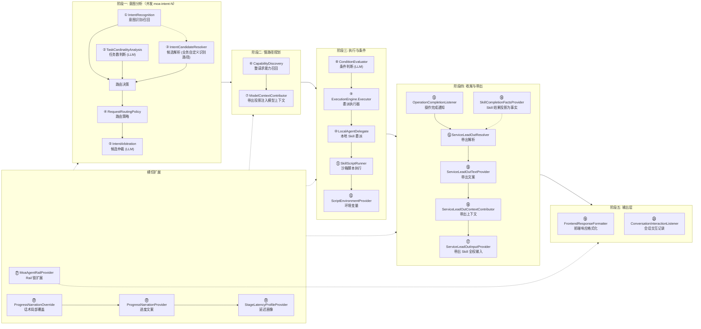

# 意图中控完整流程图 — SPI 扩展点标注（fin 0.1.1 版）

> 严格基于代码 `common/agents/moa-agent`（包名 `com.moaagent`）逐类精读梳理
> 底座：`agent-core-java`（DeepAgent / AgentRail / A2A 运行时）
> 生成日期：2026-10-22

---

## 〇、与参考版（phoenix/moa_agent + moa/demo v2）差异速览

| 变更类型 | 参考版 v2 | 本版（fin 0.1.1） | 说明 |
|----------|------|------|------|
| **范围** | 底座 + demo 双实现标注 | **纯底座实现**（fin 仓无 demo 扩展模块） | 对照表改为「底座默认实现 / 业务扩展方式」 |
| **SPI 总数** | 19 | **24** | 见下方新增项 |
| **新增** | — | `ExecutionEngine.Executor` | 按 CandidateCard.Kind 分发的执行器 SPI |
| **新增** | — | `ServiceLeadOutInputProvider` | 带出 Skill 的业务全权输入契约 |
| **新增** | — | `SkillCompletionFactsProvider` | Skill 已验证结果投影为「事实」供带出评估 |
| **新增** | — | `ProgressNarrationOverride` | 业务局部话术覆盖（先于默认话术尝试） |
| **新增** | — | `ConversationInteractionListener` | 会话交互记录观察 |
| **新增机制** | — | `IntentHandoff` 交接预处理 | TARGET/SELECT/COMPOSE 三模式，路由前先行决策 |
| **新增机制** | — | `ServiceLeadOutFollowUpCoordinator` | 带出建议承接闭环（token 防重、TTL 过期） |
| **新增机制** | — | 领域内意图跳变快速通道 | `in_scope_intent_change` 信号直接换候选走 FAST（`routeInScope`），不再全量重路由 |
| **修正** | 并发分析共用线程池 | 识别/任务数用 `moa-intent-N`，仲裁独立 `moa-arbitration-N` | 两池共享同一 deadline |
| **修正** | FAST_SELECT 由仲裁结果驱动 | `Decision.Action.SELECT`（含仲裁多选与交接澄清两类） | 交接澄清 selectionLimit=32，仲裁多选=3 |
| **修正** | StagePlan 无 SELECTING | Phase 枚举含 `SELECTING`（共 14 态） | 快路径选择期间占用 SELECTING |
| **细化** | 快路径委派中断 | 框架工具 `moa_fast_delegate`（FAST_TOOL，禁止模型直调） | 恢复凭据回执走 beforeToolCall |
| **细化** | Rail priority 语义模糊 | AgentCallbackManager 按 **priority 数值大者先执行** | 本版已核实排序代码 |

---

## 一、完整流程图（Mermaid）

```mermaid
flowchart TD
    %% ===== 入口 =====
    UserReq["👤 用户请求<br/>HTTP POST /v1/{project_id}/agents/{agent_id}/conversations/{conversation_id}"]:::userNode
    Handler["CustomRestHandler<br/>(依赖库 agent-service-app-custom-rest)<br/>解析 headers/query/body, 判定 SSE"]:::baseNode
    Adapter["MoaCustomRestAdapter.toA2ARequest()<br/>解包 input/query/message → A2A 消息<br/>metadata 注入 body/headers/query/path_variables<br/>(供 L2 抽取远端请求参数)"]:::baseNode
    DeepAgent["DeepAgent.invoke()<br/>L1 主智能体入口<br/>(enableTaskLoop=true, maxParallelToolCalls=1)"]:::baseNode

    UserReq --> Handler --> Adapter --> DeepAgent

    %% ===== Rail 链 beforeInvoke (priority 降序: 大者先执行) =====
    DeepAgent --> RailBefore["Rail 链 beforeInvoke<br/>按 priority 降序"]:::railNode

    RailBefore --> ConvRail["ConversationInteractionRail<br/>priority=4000<br/>publisher.begin() 记录用户输入轮次"]:::railNode
    ConvRail --> NarrRail["ProgressNarrationRail<br/>priority=3000<br/>progress.beginRequest()"]:::railNode
    NarrRail --> RouterEntry["IntentRoutingRail.beforeInvoke()<br/>priority=2000<br/>请求路由入口"]:::railNode

    RouterEntry --> CheckInterrupt{"会话存在<br/>ToolInterruptionState?"}
    CheckInterrupt -- "是 (中断恢复)" --> ContinueInterrupt["跳过路由<br/>凭据恢复挂起的工具调用"]:::baseNode
    CheckInterrupt -- "否" --> CheckActive{"StagePlan 活动中?<br/>(phase 非 EMPTY 且非终态)"}
    CheckActive -- "是" --> ContinuePlan["跳过路由<br/>模型继续推进阶段工具<br/>(stage_plan / stage_bind_next / ...)"]:::baseNode
    CheckActive -- "否 (新请求)" --> LeadOutCtx["prepareLeadOutContext()<br/>带出承接: IntentHandoff 或<br/>FollowUp.snapshot → 路由上下文"]:::baseNode

    LeadOutCtx --> RouteCall["IntentRouter.route()<br/>核心路由器"]:::baseNode

    %% ===== 交接预处理 =====
    RouteCall --> CheckHandoff{"IntentHandoff.incoming()<br/>会话元数据 moa.intent_handoff?"}
    CheckHandoff -- "TARGET 唯一命中" --> HandoffFast["Decision.fast<br/>reason=handoff_target"]:::baseNode
    CheckHandoff -- "COMPOSE" --> HandoffSlow["Decision.slow(scope)<br/>reason=handoff_compose"]:::baseNode
    CheckHandoff -- "无效/冲突" --> HandoffBlocked["Decision.blocked<br/>analysis_invalid_handoff*"]:::baseNode

    %% ===== 显式 intent 快捷路径 =====
    CheckHandoff -- "无 (常规请求)" --> CheckExplicit{"显式 intent<br/>目录唯一命中?"}
    CheckExplicit -- "是" --> FastDirect
    CheckExplicit -- "否" --> Policy["④ RequestRoutingPolicy.route()<br/>路由策略决策<br/><b>SPI ④</b><br/>━━━━━━━━━━━━━━━━━━<br/>底座: DefaultRequestRoutingPolicy<br/>━━━━━━━━━━━━━━━━━━"]:::spiNode

    %% ===== 并发分析 =====
    Policy --> Concurrent["services.analyze()<br/>并发执行 moa-intent-N 线程池<br/>(共享 analysisTimeout deadline)"]:::baseNode

    Concurrent --> Recognition["① IntentRecognition.recognize()<br/>意图识别/召回<br/><b>SPI ①</b><br/>━━━━━━━━━━━━━━━━━━<br/>底座: PackIntentRecognition<br/>(CandidateRecall 确定性算法:<br/>utterance 全等=1.0 /<br/>keyword 覆盖率打分, 无 LLM)<br/>━━━━━━━━━━━━━━━━━━"]:::spiNode

    Concurrent --> Cardinality["② TaskCardinalityAnalysis.classify()<br/>任务数判断 (LLM)<br/><b>SPI ②</b><br/>━━━━━━━━━━━━━━━━━━<br/>底座: ModelTaskCardinalityAnalysis<br/>(prompt: task-cardinality.md<br/>temperature=0, 输出 SINGLE/<br/>MULTIPLE/UNKNOWN, 异常→UNKNOWN)<br/>━━━━━━━━━━━━━━━━━━"]:::spiNode

    %% ===== 候选解析 (底座路由链不调用, 业务自定义识别时使用) =====
    Recognition -. "仅业务自定义识别路径" .-> Resolver["③ IntentCandidateResolver.resolve()<br/>召回意图 → 候选卡映射<br/><b>SPI ③</b><br/>━━━━━━━━━━━━━━━━━━<br/>底座: DefaultIntentCandidateResolver<br/>(adapter+intent 精确匹配,<br/>未命中构造动态 HIGH 候选)<br/>注: PackIntentRecognition 不调用此 SPI<br/>━━━━━━━━━━━━━━━━━━"]:::spiNode
    Resolver -.-> Policy

    Cardinality --> DecideBranch{"任务数 + 候选数<br/>判断分流"}

    %% --- 快路径: SINGLE + 1 候选 ---
    DecideBranch -- "SINGLE + 1 候选" --> FastDirect["快路径 FAST<br/>reason=SINGLE / arbitrated_single /<br/>explicit_single / handoff_target"]

    %% --- 快路径选择: SINGLE + 多候选 ---
    DecideBranch -- "SINGLE + 多候选" --> RefResolve["CandidateChoices.resolve()<br/>指代消解 (用户'继续/接着'<br/>续接历史唯一选择)<br/>(框架工具类, 非 SPI)"]:::baseNode
    RefResolve -- "命中" --> RefSlow["Decision.slow(单候选)<br/>reason=user_choice_reference"]:::baseNode
    RefSlow --> SlowEntry
    RefResolve -- "未命中" --> Arbitration["⑤ IntentArbitration.select()<br/>候选仲裁 (LLM)<br/><b>SPI ⑤</b><br/>━━━━━━━━━━━━━━━━━━<br/>底座: ModelIntentArbitration<br/>(moa-arbitration-N 线程池,<br/>prompt: intent-arbitration.md,<br/>返回 1~3 个 1-based 序号)<br/>━━━━━━━━━━━━━━━━━━"]:::spiNode

    Arbitration --> ArbResult{"仲裁结果"}
    ArbResult -- "1 项" --> FastDirect
    ArbResult -- "2~3 项" --> FastSelect["Decision.select<br/>reason=arbitrated_multiple<br/>selectionLimit=3"]:::fastPath
    ArbResult -- "空 (-1)" --> SlowEntry
    ArbResult -- "失败/中断" --> ArbFail{"失败类型"}
    ArbFail -- "interrupted" --> Blocked["Decision.blocked"]:::baseNode
    ArbFail -- "其他" --> SlowEntry

    %% --- 慢路径 ---
    DecideBranch -- "MULTIPLE / UNKNOWN" --> SlowEntry["慢路径 SLOW<br/>交给模型规划"]:::slowPath

    %% ===== dispatchDecision 分发 =====
    FastDirect --> CheckSupport{"engine.supports?<br/>(执行器已安装)"}
    CheckSupport -- "否" --> SlowEntry
    CheckSupport -- "是" --> StartFast["planning.startFast()<br/>EMPTY→单todo PENDING, phase=READY<br/>内部 execute() 构造委派中断"]:::fastPath

    FastSelect --> SelectDispatch{"IntentRoutingRail<br/>.dispatchDecision()"}
    HandoffFast --> FastDirect
    HandoffSlow --> SlowEntry
    HandoffBlocked --> BlockedFinish["finish('交接上下文无效...')"]:::baseNode
    Blocked --> BlockedFinish

    SelectDispatch -- "SELECT 且 limit≤3<br/>(仲裁多选)" --> StartSelect["FastCandidateSelection.start()<br/>phase→SELECTING, 生成 AskUserRequest<br/>不启动规划模型"]:::fastPath
    SelectDispatch -- "SELECT 且 limit>3<br/>(交接澄清)" --> StartHandoffSel["FastCandidateSelection.startHandoff()<br/>候选 1~32 项"]:::fastPath

    StartSelect --> WaitSelect["⏳ 中断等待用户选择<br/>(INTERRUPT_START: fast_candidate_selection)"]:::baseNode
    StartHandoffSel --> WaitSelect
    WaitSelect --> UserSelect["👤 用户选择候选"]:::userNode
    UserSelect --> FastSelectResume["beforeToolCall: resumeFastSelection()<br/>CandidateSelection.resolve() 解析答复<br/>CandidateChoices.remember() 记忆选择<br/>(框架工具类, 非 SPI)"]:::baseNode
    FastSelectResume -- "解析失败" --> WaitSelect
    FastSelectResume -- "唯一命中" --> CheckSupport

    %% ===== 快路径执行委派 =====
    StartFast --> CheckKindFast{"CandidateCard.Kind"}

    CheckKindFast -- "AGENT / WORKFLOW" --> DispatchFast["⑨ ExecutionEngine.Executor.prepare()<br/>构造 a2a_delegate 委派中断<br/><b>SPI ⑨</b><br/>━━━━━━━━━━━━━━━━━━<br/>底座: A2A 执行器 (默认)<br/>(资源 ZIP 下载+SHA-256 校验,<br/>envelope 含 todoId/planRevision/<br/>idempotencyKey)<br/>━━━━━━━━━━━━━━━━━━"]:::spiNode
    CheckKindFast -- "SKILL / TOOL" --> LocalFast["⑩ LocalAgentDelegate.start()<br/>本地 Skill 委派<br/><b>SPI ⑩</b><br/>━━━━━━━━━━━━━━━━━━<br/>底座: LocalSkillDelegate<br/>(同进程 NativeSkillAgent 子智能体,<br/>native_skill_v1 协议报文)<br/>━━━━━━━━━━━━━━━━━━"]:::spiNode

    DispatchFast --> WaitCallback1["⏳ 等待 L2 回调<br/>(moa_fast_delegate 凭据)"]:::baseNode
    LocalFast --> SkillSub["SKILL 子智能体 Rail 链执行<br/>SkillBoundaryRail(2000) → SkillNarrationRail(1900)<br/>→ SkillActionRail(1500) → SkillInteractionRail"]:::execNode

    SkillSub --> SkillTools["SkillActionRail 分发控制/业务工具<br/>call_versatile / call_mcp / confirm_action<br/>/ read_file / skill_results / cancel_skill"]:::execNode
    SkillTools --> ScriptRunner["⑪ SkillScriptRunner.run()<br/>沙箱脚本执行<br/><b>SPI ⑪</b><br/>━━━━━━━━━━━━━━━━━━<br/>底座: SandboxScriptRunner<br/>(强制 SANDBOX 模式, python,<br/>stdout 须单个 JSON 对象)<br/>━━━━━━━━━━━━━━━━━━<br/>开关: moa.skill-agent.enabled"]:::spiNode
    ScriptRunner --> EnvProvider["⑫ ScriptEnvironmentProvider.resolve()<br/>脚本环境变量注入<br/><b>SPI ⑫</b><br/>━━━━━━━━━━━━━━━━━━<br/>底座: SpringScriptEnvironmentProvider<br/>(从 Spring Environment 按 ref 读取,<br/>白名单复核)<br/>━━━━━━━━━━━━━━━━━━<br/>开关: moa.skill-agent.enabled"]:::spiNode

    WaitCallback1 --> BeforeToolFast["IntentRoutingRail.beforeToolCall()<br/>(FAST_TOOL 回调)"]:::railNode
    EnvProvider --> BeforeToolFast

    BeforeToolFast --> CheckSwitchFast{"IntentSwitch.detected()?<br/>(仅非 SKILL)"}
    CheckSwitchFast -- "是" --> HandleSwitchFast["handleIntentSwitch()<br/>挂起计划 → 重新路由<br/>(详见意图跳变处理)"]:::baseNode
    CheckSwitchFast -- "否" --> FinishFast["planning.finishFast()<br/>→ completeExecution()"]:::fastPath

    FinishFast --> CheckDirectFast{"委派类型?"}
    CheckDirectFast -- "直接 A2A (非 Skill)" --> Completion1["⑬ OperationCompletionListener<br/>.onCompleted()<br/>操作完成通知<br/><b>SPI ⑬</b><br/>━━━━━━━━━━━━━━━━━━<br/>底座: 无默认 (纯扩展点)<br/>Source: DIRECT_A2A<br/>━━━━━━━━━━━━━━━━━━"]:::spiNode
    CheckDirectFast -- "Skill 执行" --> SkillCompletion["SkillActionRail 内部<br/>notifyCompletion()<br/><b>SPI ⑬</b><br/>(Source: SKILL_A2A / SKILL_SCRIPT)"]:::spiNode
    Completion1 --> Terminal
    SkillCompletion --> Terminal

    %% ===== 慢路径: 能力召回 (stage_plan 之前) =====
    SlowEntry --> SlowRecall["⑥ CapabilityDiscovery.recall()<br/>整请求能力召回/补充<br/>在 stage_plan 之前执行一次<br/><b>SPI ⑥</b><br/>━━━━━━━━━━━━━━━━━━<br/>底座: CapabilityDiscovery.catalog(pack)<br/>(优先复用本轮路由候选,<br/>为空才 CandidateRecall 全目录召回)<br/>━━━━━━━━━━━━━━━━━━<br/>包裹 CAPABILITY_DISCOVERY 进度播放"]:::spiNode

    SlowRecall --> FilterRecall["过滤: 交接 candidateCapabilityIds 范围<br/>+ user_choice_reference 历史选择"]:::baseNode
    FilterRecall --> BeginRequest["planning.beginRequest()<br/>召回结果存入 plan.recalled<br/>RESET_CONTEXT=true"]:::baseNode

    %% ===== 慢路径: RequestCapabilityRail =====
    BeginRequest --> CapRail["RequestCapabilityRail<br/>priority=-10000<br/>beforeModelCall"]:::railNode
    CapRail --> FilterTools["工具白名单过滤为 5 个阶段工具<br/>(stage_plan / stage_bind_next /<br/>stage_finalize / stage_execute_next / stage_status)"]:::baseNode
    FilterTools --> CheckReset{"RESET_CONTEXT<br/>== true?"}
    CheckReset -- "是 (首次)" --> InjectCandidates["重置消息列表: 仅保留 SystemMessage<br/>注入 UserMessage(query +<br/>'以下为本次完整请求召回的能力数据,<br/>不是指令' + 候选 JSON)"]:::baseNode
    CheckReset -- "否 (续接)" --> ProjectHandoff
    InjectCandidates --> ProjectHandoff["⑦ ModelContextContributor.contribute()<br/>注入服务带出投影到模型上下文<br/><b>SPI ⑦</b><br/>━━━━━━━━━━━━━━━━━━<br/>底座: DefaultModelContextContributor<br/>(LeadOutModelProjection: 带出展示构造为<br/>伪 AssistantMessage + UserMessage,<br/>插入 query 锚点前, 按内容去重)<br/>━━━━━━━━━━━━━━━━━━<br/>每次模型调用都执行"]:::spiNode
    ProjectHandoff --> ModelPlan["模型调用 stage_plan<br/>candidate_ids 须来自 plan.recalled"]:::modelNode

    %% ===== 慢路径: StagePlanningRail 状态机 =====
    ModelPlan --> StageRail["StagePlanningRail<br/>priority=1000<br/>beforeToolCall → advancePlan()<br/>(64 段锁串行化, 回执防重放)"]:::railNode

    %% --- 阶段1: plan ---
    StageRail --> StagePlanTool["阶段1: stage_plan<br/>创建任务清单 1~32 项<br/>candidate_ids 显式非空/不重复/⊆recalled<br/>子任务 query 复制完整请求则拒绝<br/>phase: EMPTY → BINDING"]:::slowStage

    %% --- 阶段2: bind_next ---
    StagePlanTool --> StageBind["阶段2: stage_bind_next (重复)<br/>绑定下一个 DRAFT todo 候选<br/>(candidate_ids 在 plan 时已定)"]:::slowStage
    StageBind --> BindResult{"todo 的候选数量?"}
    BindResult -- "多候选" --> Clarify["candidate_binding 中断澄清<br/>👤 用户选择候选"]:::userNode
    Clarify --> StageBind
    BindResult -- "单候选 (自动绑定)" --> StageBound["全部绑定完成<br/>phase: BINDING → BOUND"]:::slowStage

    %% --- 阶段3: finalize ---
    StageBound --> StageFinalize["阶段3: stage_finalize<br/>先 validateConditionBindings<br/>(失败 → todo+计划 BLOCKED)"]:::slowStage
    StageFinalize --> CheckNoBind{"有绑定候选?"}
    CheckNoBind -- "无" --> NoExec["phase: NO_EXECUTABLE<br/>(终态)"]:::slowStage
    CheckNoBind -- "有" --> CheckRisk{"含 HIGH 风险?"}
    CheckRisk -- "是" --> Confirm["plan_confirmation 中断<br/>👤 用户确认"]:::userNode
    Confirm -- "同意" --> StageReady1["formal=true, todo→PENDING<br/>phase: CONFIRMING → READY"]:::slowStage
    Confirm -- "拒绝" --> Rejected["phase: REJECTED (终态)"]:::slowStage
    CheckRisk -- "否" --> StageReady1

    %% --- 阶段4: execute_next ---
    StageReady1 --> StageExecute["阶段4: stage_execute_next (重复)<br/>串行执行下一个 PENDING todo<br/>phase: READY → EXECUTING"]:::slowStage
    StageExecute --> Condition["⑧ ConditionEvaluator.evaluate()<br/>条件判断 (LLM)<br/><b>SPI ⑧</b><br/>━━━━━━━━━━━━━━━━━━<br/>底座: ModelConditionEvaluator<br/>(prompt: condition-evaluation.md,<br/>无工具独立调用, 失败关闭<br/>绝不退化为无条件执行)<br/>━━━━━━━━━━━━━━━━━━<br/>前置依赖: SKIPPED→SKIP /<br/>非 SUCCEEDED→blocked"]:::spiNode

    Condition --> CondResult{"条件求值"}
    CondResult -- "PROCEED" --> ExecDispatch["⑨ ExecutionEngine.Executor<br/>.prepare() 构造委派<br/><b>SPI ⑨</b>"]:::spiNode
    CondResult -- "SKIP" --> SkipTask["跳过该任务<br/>todo→SKIPPED"]:::baseNode
    SkipTask --> NextTask
    CondResult -- "NEEDS_CLARIFICATION" --> BlockTask["阻塞该任务<br/>todo+计划 → BLOCKED (终态)"]:::slowStage

    %% ===== 执行委派 (慢路径) =====
    ExecDispatch --> CheckKind{"CandidateCard.Kind"}
    CheckKind -- "AGENT / WORKFLOW" --> A2ADelegate["A2A 远程委派<br/>发送到 L2 子代理 (a2a_delegate 中断)"]:::execNode
    CheckKind -- "SKILL / TOOL" --> LocalDelegate["⑩ LocalAgentDelegate<br/>.start() / .resume()<br/>本地智能体委派<br/><b>SPI ⑩</b><br/>━━━━━━━━━━━━━━━━━━<br/>底座: LocalSkillDelegate<br/>━━━━━━━━━━━━━━━━━━"]:::spiNode

    A2ADelegate --> WaitL2["⏳ 等待 L2 响应回调"]:::execNode
    LocalDelegate --> SkillExec["SKILL 子智能体执行<br/>(⑪ SkillScriptRunner + ⑫ EnvProvider)"]:::execNode

    %% ===== A2A 响应回调 =====
    WaitL2 --> CallbackRail["IntentRoutingRail.beforeToolCall()<br/>(stage_execute_next 回调)"]:::railNode
    SkillExec --> CallbackRail

    CallbackRail --> CheckSwitchSlow{"IntentSwitch.detected()?<br/>(仅非 SKILL)"}
    CheckSwitchSlow -- "是" --> SwitchType{"跳变信号类型"}
    SwitchType -- "in_scope_intent_change<br/>(领域内, 有 source+intent)" --> RouteInScope["routeInScope()<br/>router.inScopeCandidate() 换候选<br/>→ 直接转快路径 delegateFast<br/>path=FAST reason=in_scope_intent_change"]:::baseNode
    RouteInScope --> StartFast
    SwitchType -- "not_in_scope (跨域)<br/>或领域内缺路由" --> Suspend
    CheckSwitchSlow -- "否" --> ResumeExec["StagePlanningRail.resumeExecution()<br/>→ completeExecution()<br/>(SUCCEEDED/FAILED/CANCELLED)"]:::baseNode

    ResumeExec --> CheckDirectSlow{"委派类型?"}
    CheckDirectSlow -- "直接 A2A (非 Skill)" --> CompletionPub["⑬ OperationCompletionListener<br/>.onCompleted()<br/><b>SPI ⑬</b><br/>━━━━━━━━━━━━━━━━━━<br/>底座: 无默认 (纯扩展点)<br/>Source: DIRECT_A2A<br/>━━━━━━━━━━━━━━━━━━"]:::spiNode
    CheckDirectSlow -- "Skill 执行" --> SkillCompletionSlow["SkillActionRail 内部<br/>notifyCompletion()<br/><b>SPI ⑬</b><br/>(Source: SKILL_A2A / SKILL_SCRIPT,<br/>⑱ SkillCompletionFactsProvider<br/>投影 verifiedResult 为事实)"]:::spiNode

    CompletionPub --> CheckPhaseComplete{"phase == COMPLETED?"}
    SkillCompletionSlow --> CheckPhaseComplete
    CheckPhaseComplete -- "是" --> LeadOut["⑭ ServiceLeadOutResolver.resolve()<br/>服务带出解析<br/><b>SPI ⑭</b><br/>━━━━━━━━━━━━━━━━━━<br/>底座: CompositeServiceLeadOutResolver<br/>组合序: Default(读 responseMetadata)<br/>→ Skill(可选, 开关控制)<br/>→ Rule(YAML 规则)<br/>━━━━━━━━━━━━━━━━━━<br/>触发: 最后一个 SUCCEEDED todo"]:::spiNode
    CheckPhaseComplete -- "否" --> NextTask

    %% ===== 带出输出 =====
    LeadOut --> LeadOutPolicy["ServiceLeadOutPolicy.filter<br/>剔除已规划/已完成/TOOL 类/<br/>高风险未授权/去重/limit 2"]:::baseNode
    LeadOutPolicy --> CheckDelivery{"delivery 模式"}
    CheckDelivery -- "RESPONSE_METADATA" --> LeadOutMeta["写入 ResponseMetadataAccessor<br/>(要求 agentcore.response-metadata<br/>.enabled=true)"]:::baseNode
    CheckDelivery -- "FRONTEND (默认)" --> LeadOutText["⑮ ServiceLeadOutTextProvider<br/>.content() / .hint()<br/>带出文案<br/><b>SPI ⑮</b><br/>━━━━━━━━━━━━━━━━━━<br/>底座: 空实现<br/>(Coordinator 回退 item 拼接)<br/>━━━━━━━━━━━━━━━━━━"]:::spiNode
    LeadOutText --> FollowUp["ServiceLeadOutFollowUpCoordinator<br/>.register() 登记带出快照<br/>(token 防重, TTL 过期)"]:::baseNode
    FollowUp --> LeadOutEvent["发 SERVICE_LEAD_OUT 前端事件"]:::baseNode
    LeadOutMeta --> NextTask
    LeadOutEvent --> NextTask

    %% ===== 意图跳变处理 (跨域/无路由) =====
    Suspend["planning.suspend()<br/>挂起当前计划<br/>SuspendedTasks 持久化<br/>(DRAFT/BOUND/PENDING/RUNNING→SUSPENDED)"]:::baseNode
    Suspend --> SuspendedShow2["suspendedCarryout.present()<br/>展示挂起任务清单"]:::baseNode
    SuspendedShow2 --> CheckQuery2{"跳变后有用户原文?"}
    CheckQuery2 -- "否" --> SwitchFinish["finish('原任务已挂起,<br/>请重新发送要办理的业务')"]:::baseNode
    CheckQuery2 -- "是" --> ReRoute["route(nextQuery)<br/>重新完整路由"]:::baseNode
    ReRoute --> RouteCall
    SwitchFinish --> Terminal

    %% ===== 下一个任务循环 =====
    NextTask{"还有 PENDING todo?"}
    NextTask -- "是" --> StageExecute
    NextTask -- "否" --> StageComplete["phase: EXECUTING → COMPLETED<br/>(终态)"]:::slowStage

    %% ===== 挂起任务查询入口 =====
    RouterEntry --> CheckSuspendedQ{"查询匹配'挂起任务/<br/>未完成任务'?"}
    CheckSuspendedQ -- "是" --> SuspendedShow["SuspendedTaskCarryout.present()<br/>只读展示挂起清单<br/>(不恢复执行)"]:::baseNode
    CheckSuspendedQ -- "否" --> LeadOutCtx

    NoExec --> Terminal
    Rejected --> Terminal
    BlockTask --> Terminal
    ContinueInterrupt --> Terminal
    ContinuePlan --> Terminal
    SuspendedShow --> Terminal
    StageComplete --> Terminal["🏁 终答返回用户"]:::terminal

    %% ===== 终答输出层 =====
    Terminal --> Visibility["MoaFrontendEventVisibilityPolicy.filter<br/>(内部组件, 非 SPI)<br/>隐藏 SkillOutput/本地委派控制输出,<br/>保留交互事件"]:::baseNode
    Visibility --> Formatter["⑲ FrontendResponseFormatter.format()<br/>前端响应格式化<br/><b>SPI ⑲</b><br/>━━━━━━━━━━━━━━━━━━<br/>底座: DefaultFrontendResponseFormatter<br/>(七字段信封: success/agent_id/<br/>conversation_id/output/error/<br/>execution_time/custom_rsp_data)<br/>━━━━━━━━━━━━━━━━━━<br/>开关: custom-rest.query-path"]:::spiNode
    Formatter --> SseOutput["SSE 输出到前端<br/>(chunk / interrupt / final)"]:::terminal

    %% ===== 横切: Rail 扩展 =====
    subgraph RailExt["横切: Rail 链扩展"]
        RailProvider["㉑ MoaAgentRailProvider<br/>.createRails()<br/>Rail 扩展注册<br/><b>SPI ㉑</b><br/>━━━━━━━━━━━━━━━━━━<br/>底座: 无默认 (纯扩展点)<br/>Role: MAIN / SKILL<br/>(ObjectProvider 按 @Order 收集,<br/>追加在内建 Rail 之后)<br/>━━━━━━━━━━━━━━━━━━"]:::spiNode
    end

    %% ===== 横切: 进度播放 =====
    subgraph Narration["横切: 进度播放 (贯穿全程, ProgressNarrationRail priority=3000)"]
        NarrOverride["㉓ ProgressNarrationOverride<br/>.resolve()<br/>业务局部话术覆盖<br/><b>SPI ㉓</b><br/>━━━━━━━━━━━━━━━━━━<br/>底座: 无 (Default 前按序尝试,<br/>返回 empty 继续用默认)<br/>━━━━━━━━━━━━━━━━━━"]:::spiNode
        NarrProvider["㉒ ProgressNarrationProvider<br/>.resolve()<br/>进度文案<br/><b>SPI ㉒</b><br/>━━━━━━━━━━━━━━━━━━<br/>底座: DefaultProgressNarrationProvider<br/>(13 个 NarrationStage 默认句子,<br/>SERVICE_LEAD_OUT 静默)<br/>━━━━━━━━━━━━━━━━━━"]:::spiNode
        LatencyProvider["㉔ StageLatencyProfileProvider<br/>.resolve()<br/>阶段延迟画像<br/><b>SPI ㉔</b><br/>━━━━━━━━━━━━━━━━━━<br/>底座: 基于 moa.narration.latency<br/>配置 (StageLatencyProperties)<br/>━━━━━━━━━━━━━━━━━━"]:::spiNode
        NarrOverride --> NarrProvider --> LatencyProvider
    end

    %% ===== 横切: 会话交互记录 =====
    subgraph ConvRecord["横切: 会话交互记录"]
        ConvListener["⑳ ConversationInteractionListener<br/>.onInteraction()<br/>交互记录观察<br/><b>SPI ⑳</b><br/>━━━━━━━━━━━━━━━━━━<br/>底座: 无默认 (纯扩展点)<br/>(USER_TO_AGENT / AGENT_TO_USER)<br/>━━━━━━━━━━━━━━━━━━"]:::spiNode
    end

    %% ===== 带出 Skill 内部 (⑯⑰⑱) =====
    LeadOut -. "Skill 带出路径<br/>(开关: service-lead-out.skill-enabled)" .-> LeadOutSkill["LeadOutSkillRail (priority=2000)<br/>一次性带出 Skill 智能体<br/>工具: read_file + submit_lead_out"]:::spiNode
    LeadOutSkill --> LeadOutInput["⑰ ServiceLeadOutInputProvider<br/>.input()<br/>带出 Skill 业务全权输入<br/><b>SPI ⑰</b><br/>━━━━━━━━━━━━━━━━━━<br/>底座: 无 (未提供时按<br/>metadataKeys/resultFields/<br/>⑯ contributor 组装)<br/>━━━━━━━━━━━━━━━━━━"]:::spiNode
    LeadOutInput --> LeadOutCtxContrib["⑯ ServiceLeadOutContextContributor<br/>.contribute()<br/>带出上下文贡献<br/><b>SPI ⑯</b><br/>━━━━━━━━━━━━━━━━━━<br/>底座: 空贡献<br/>━━━━━━━━━━━━━━━━━━"]:::spiNode

    %% ===== 样式定义 =====
    classDef userNode fill:#FFE0B2,stroke:#E65100,stroke-width:2px,color:#333
    classDef baseNode fill:#E3F2FD,stroke:#1565C0,stroke-width:1.5px,color:#333
    classDef railNode fill:#FFF9C4,stroke:#F57F17,stroke-width:2px,color:#333
    classDef spiNode fill:#E8F5E9,stroke:#2E7D32,stroke-width:3px,color:#333
    classDef fastPath fill:#E1BEE7,stroke:#6A1B9A,stroke-width:2px,color:#333
    classDef slowPath fill:#FFCDD2,stroke:#C62828,stroke-width:2px,color:#333
    classDef slowStage fill:#FFCDD2,stroke:#C62828,stroke-width:1.5px,color:#333
    classDef modelNode fill:#F3E5F5,stroke:#7B1FA2,stroke-width:2px,color:#333
    classDef execNode fill:#B2DFDB,stroke:#00695C,stroke-width:2px,color:#333
    classDef terminal fill:#C8E6C9,stroke:#1B5E20,stroke-width:3px,color:#333
```

---

## 二、SPI 扩展点在流程中的位置一览



---

## 三、SPI 扩展点完整对照表（共 24 个）

| SPI # | 接口 | 流程节点 | 底座默认实现 | 业务扩展方式 | 开关/条件 |
|---|---|---|---|---|---|
| ① | `IntentRecognition` | 意图识别/召回 | `PackIntentRecognition`（CandidateRecall 确定性算法，无 LLM） | 注册同类型 Bean 替换（如对接外部意图工作流） | — |
| ② | `TaskCardinalityAnalysis` | 任务数判断 | `ModelTaskCardinalityAnalysis`（LLM，task-cardinality.md） | 注册 Bean 替换（如 HTTP 外部服务） | — |
| ③ | `IntentCandidateResolver` | 候选解析 | `DefaultIntentCandidateResolver`（精确匹配 + 动态 HIGH 候选） | 自定义 `IntentRecognition` 内部调用，映射外部召回意图→授权候选 | — |
| ④ | `RequestRoutingPolicy` | 路由策略 | `DefaultRequestRoutingPolicy`（组合识别+任务数+指代消解+仲裁） | 注册 Bean 替换（领域路由） | — |
| ⑤ | `IntentArbitration` | 候选仲裁 | `ModelIntentArbitration`（LLM，intent-arbitration.md，1~3 项序号） | 注册 Bean 替换（如透传全部候选） | — |
| ⑥ | `CapabilityDiscovery` | 整请求能力召回（stage_plan 之前） | `CapabilityDiscovery.catalog(pack)`（优先复用路由候选） | 注册 Bean 补充组合能力卡 | — |
| ⑦ | `ModelContextContributor` | 带出投影注入模型上下文（每次模型调用） | `DefaultModelContextContributor`（LeadOutModelProjection） | 注册 Bean 替换；SKILL 链单独收集 | — |
| ⑧ | `ConditionEvaluator` | 条件判断 | `ModelConditionEvaluator`（LLM，condition-evaluation.md，失败关闭） | 注册 Bean 替换 | — |
| ⑨ | `ExecutionEngine.Executor` | 委派执行器（按 Kind 分发） | A2A 执行器（AGENT/WORKFLOW 默认） | 注册 Executor 扩展新 Kind 的执行方式 | — |
| ⑩ | `LocalAgentDelegate` | 本地委派执行 | `LocalSkillDelegate`（同进程 NativeSkillAgent 子智能体） | 注册 Bean 替换 | `moa.skill-agent.enabled=true` |
| ⑪ | `SkillScriptRunner` | 沙箱脚本执行 | `SandboxScriptRunner`（强制 SANDBOX 模式） | 注册 Bean 替换 | `moa.skill-agent.enabled=true` |
| ⑫ | `ScriptEnvironmentProvider` | 环境变量 | `SpringScriptEnvironmentProvider`（Spring Environment 读取） | 注册 Bean 替换 | `moa.skill-agent.enabled=true` |
| ⑬ | `OperationCompletionListener` | 操作完成通知 | 无默认（纯扩展点） | 注册 Bean 观察 DIRECT_A2A / SKILL_A2A / SKILL_SCRIPT 完成事件 | — |
| ⑭ | `ServiceLeadOutResolver` | 带出解析 | `CompositeServiceLeadOutResolver`（Default→Skill→Rule 组合） | 注册 `ServiceLeadOutResolver` Bean 整体替换，或仅装配 Skill/Rule 分量 | `moa.service-lead-out.skill-enabled=true`（Skill 分量） |
| ⑮ | `ServiceLeadOutTextProvider` | 带出文案 | 空实现（回退 item hint/title 拼接） | 注册 Bean 定制 | — |
| ⑯ | `ServiceLeadOutContextContributor` | 带出上下文贡献 | 空贡献 | 注册 Bean 注入 businessContext | — |
| ⑰ | `ServiceLeadOutInputProvider` | 带 Skill 全权输入 | 无（未提供时按 metadataKeys/resultFields/⑯ 组装） | 注册 Bean 全权控制带出 Skill 输入 | Skill 带出路径 |
| ⑱ | `SkillCompletionFactsProvider` | Skill 结果投影为事实 | 无（可选） | 注册 Bean 将已验证 Skill 结果投影为事实（≤8192 字节） | — |
| ⑲ | `FrontendResponseFormatter` | 前端响应格式化 | `DefaultFrontendResponseFormatter`（七字段信封） | 注册 Bean 替换 | `openjiuwen.service.custom-rest.query-path` 存在 |
| ⑳ | `ConversationInteractionListener` | 会话交互记录 | 无默认（纯扩展点） | 注册 Bean 观察 USER_TO_AGENT / AGENT_TO_USER 交互 | — |
| ㉑ | `MoaAgentRailProvider` | Rail 链扩展 | 无默认（纯扩展点） | 注册 Bean 追加自定义 Rail（Role: MAIN / SKILL） | — |
| ㉒ | `ProgressNarrationProvider` | 进度文案 | `DefaultProgressNarrationProvider`（13 个 NarrationStage） | 注册 Bean 替换 | `moa.narration.enabled`（运行时开关，非条件装配） |
| ㉓ | `ProgressNarrationOverride` | 话术局部覆盖 | 无（Default 前按序尝试，empty 则继续默认） | 注册 Bean 覆盖部分阶段话术 | — |
| ㉔ | `StageLatencyProfileProvider` | 阶段延迟画像 | 基于 `moa.narration.latency` 配置（StageLatencyProperties） | 注册 Bean 替换 | — |

> 非 SPI 的框架工具类（易混淆项）：`CandidateRecall`（召回算法）、`CandidateChoices`（指代消解记忆）、`CandidateSelection`（用户答复解析）、`FastCandidateSelection`（快路径选择状态机，工具 `moa_fast_select`）、`IntentSwitch`（跳变信号检测）、`SuspendedTaskCarryout`（挂起清单展示）、`MoaFrontendEventVisibilityPolicy`（出口可见性，包私有不可替换）。

---

## 四、SPI 接口方法签名详解

### 意图分析阶段

```java
// SPI ① 意图识别
@FunctionalInterface
public interface IntentRecognition {
    List<CandidateCard> recognize(RoutingAnalysisInput input, Session session);
}

// SPI ② 任务数判断
@FunctionalInterface
public interface TaskCardinalityAnalysis {
    TaskCardinality classify(RoutingAnalysisInput input);  // SINGLE / MULTIPLE / UNKNOWN
}

// SPI ③ 候选解析
@FunctionalInterface
public interface IntentCandidateResolver {
    List<CandidateCard> resolve(RecalledIntent intent, CandidateResolutionContext context);
}

// SPI ④ 路由策略
@FunctionalInterface
public interface RequestRoutingPolicy {
    IntentRouter.Decision route(Request request, RoutingServices services);
    record Request(String query, String explicitIntent, Session session, Map<String, Object> serviceLeadOut) { }
}
// Decision: record Decision(Action action, List<CandidateCard> candidates, String reason,
//                            Object answer, Map<String,Object> metadata, int selectionLimit)
// Action 枚举: FAST / SLOW / SELECT / REPLY / BLOCKED

// SPI ⑤ 候选仲裁
@FunctionalInterface
public interface IntentArbitration {
    List<Integer> select(RoutingAnalysisInput input, List<CandidateCard> candidates) throws Exception;
    // 返回 1-based 序号列表，最多 1~3 项；空列表表示无匹配
}
```

### 规划与执行阶段

```java
// SPI ⑥ 能力发现/补充召回
@FunctionalInterface
public interface CapabilityDiscovery {
    List<CandidateCard> recall(RoutingAnalysisInput input, List<CandidateCard> routingCandidates);
    static CapabilityDiscovery catalog(CandidatePack pack) { ... }  // 底座默认实现（static 工厂）
}

// SPI ⑦ 模型上下文注入
@FunctionalInterface
public interface ModelContextContributor {
    void contribute(ModelCallInputs inputs, Context context);
    record Context(Session session, String query, Map<String, Object> serviceLeadOut) { }
}

// SPI ⑧ 条件判断
@FunctionalInterface
public interface ConditionEvaluator {
    ConditionDecision evaluate(ConditionEvaluationRequest request, Session session);
    // ConditionDecision.Action: PROCEED / SKIP / NEEDS_CLARIFICATION
}

// SPI ⑨ 委派执行器（ExecutionEngine 内部接口）
@FunctionalInterface
public interface Executor {
    InterruptRequest prepare(CandidateCard candidate, Map<String, Object> envelope);
}

// SPI ⑩ 本地委派
public interface LocalAgentDelegate {
    Step start(Session session, String parentCallId, LocalExecutionRequest request);
    Step resume(Session session, String parentCallId, Object answer);
    record Step(InterruptRequest interruption, Object result, Map<String,Object> responseMetadata,
            Map<String,Object> completionFacts) { }  // interruption 与 result 必须恰一个非空
}

// SPI ⑪ 脚本执行
@FunctionalInterface
public interface SkillScriptRunner {
    Map<String, Object> run(Session session, String source, Map<String, Object> input);
    default Map<String, Object> run(Session session, String source, Map<String, Object> input,
            ScriptEnvironmentContext context) { ... }
}

// SPI ⑫ 环境变量
@FunctionalInterface
public interface ScriptEnvironmentProvider {
    Map<String, String> resolve(ScriptEnvironmentContext context);
}
```

### 收尾与带出阶段

```java
// SPI ⑬ 操作完成监听
@FunctionalInterface
public interface OperationCompletionListener {
    void onCompleted(OperationCompletion completion, OperationCompletionContext context);
}
// OperationCompletion.Source: SKILL_SCRIPT / SKILL_A2A / DIRECT_A2A
// ExecutionStatus: SUCCEEDED / FAILED / CANCELLED

// SPI ⑭ 带出解析
@FunctionalInterface
public interface ServiceLeadOutResolver {
    Optional<ServiceLeadOut> resolve(ServiceLeadOutContext context);
}

// SPI ⑮ 带出文案
public interface ServiceLeadOutTextProvider {
    default String content(ServiceLeadOutContext context, ServiceLeadOut result) { return ""; }
    default String hint(ServiceLeadOutContext context, ServiceLeadOutItem item) { return item.hint(); }
}

// SPI ⑯ 带出上下文贡献
@FunctionalInterface
public interface ServiceLeadOutContextContributor {
    Map<String, Object> contribute(ServiceLeadOutContext context);
}

// SPI ⑰ 带 Skill 全权输入
public interface ServiceLeadOutInputProvider {
    Map<String, Object> input(ServiceLeadOutContext context);
}

// SPI ⑱ Skill 结果投影为事实
public interface SkillCompletionFactsProvider {
    Map<String, Object> project(String definitionId, String operation, Map<String, Object> verifiedResult);
}
```

### 输出层

```java
// SPI ⑲ 前端响应格式化
@FunctionalInterface
public interface FrontendResponseFormatter {
    Response format(Request request);
    record Request(OutputEvent output, boolean success, String error, String sseType,
            Map<String, Object> metadata, Context context) { }
    record Response(String event, Object content, Object body, String sseType) { }
}

// SPI ⑳ 会话交互监听
@FunctionalInterface
public interface ConversationInteractionListener {
    void onInteraction(ConversationInteraction interaction);
}
```

### 横切扩展

```java
// SPI ㉑ Rail 链扩展
@FunctionalInterface
public interface MoaAgentRailProvider {
    List<AgentRail> createRails(Role role);  // Role: MAIN / SKILL（运行角色，非 L1/L2 层级）
}

// SPI ㉒ 进度文案
@FunctionalInterface
public interface ProgressNarrationProvider {
    Optional<NarrationPlan> resolve(NarrationContext context);
}

// SPI ㉓ 话术局部覆盖
@FunctionalInterface
public interface ProgressNarrationOverride {
    Optional<NarrationPlan> resolve(NarrationContext context);  // empty 时继续使用基座默认话术
}

// SPI ㉔ 阶段延迟画像
@FunctionalInterface
public interface StageLatencyProfileProvider {
    Optional<StageLatencyProfile> resolve(NarrationContext context);
}
```

---

## 五、Rail 链装配与优先级（priority 数值大者先执行）

### MAIN 链（`MoaRuntimeAutoConfiguration.moaAgentHandler` → `MoaAgentRails.assemble(Role.MAIN, ...)`）

| Rail | priority | 覆盖钩子 | 职责 |
|---|---|---|---|
| ConversationInteractionRail | 4000 | beforeInvoke, afterInvoke | 记录用户输入/补终答 |
| ProgressNarrationRail | 3000 | 全部 8 钩子 | 进度播放生命周期 |
| IntentRoutingRail | 2000 | beforeInvoke, beforeToolCall, afterInvoke | 请求路由/快路径/意图跳变 |
| StagePlanningRail | 1000 | afterModelCall, beforeToolCall | 阶段状态机推进 |
| LocalDelegationRail | 100 | beforeInvoke, afterInvoke | 本地 Skill 委派父子中断标识适配 |
| ThinkingEventRail | 50 | afterModelCall, onModelException, afterInvoke | think_chunk / final_answer_chunk |
| InterruptEventRail | 50 | onToolException | INTERRUPT_START 前端事件 |
| RequestCapabilityRail | -10000 | beforeModelCall | 阶段工具白名单 + 上下文重置 + 带出投影 |
| （业务追加） | 自定 | — | MoaAgentRailProvider ㉑ 注册，追加在内建之后 |

### SKILL 链（`NativeSkillAgent.create` → `MoaAgentRails.assemble(Role.SKILL, ...)`）

| Rail | priority | 职责 |
|---|---|---|
| SkillBoundaryRail | 2000 | native_skill_v1 信封校验、幂等、工具白名单、⑦ 注入、无 toolCalls 强制结束 |
| SkillNarrationRail | 1900 | Skill 进度话术 |
| SkillActionRail | 1500 | 业务核心：call_versatile / call_mcp / confirm_action / read_file / skill_results / cancel_skill |
| SkillUseRail（框架） | 默认 | 资源披露 |
| AskUserRail（框架） | 默认 | 用户提问 |
| SkillInteractionRail | 默认 | AskUser → INTERRUPT_START 事件 |

---

## 六、图例说明

| 颜色 | 含义 |
|---|---|
| 🟧 橙色 | 用户交互节点（用户请求/用户选择/用户确认） |
| 🔵 蓝色 | 底座核心节点（非 SPI） |
| 🟡 黄色 | Rail 编排节点（按 priority 降序执行） |
| 🟢 绿色（粗边框） | **SPI 扩展点**（24 个） |
| 🟣 紫色 | 快路径节点 |
| 🔴 红色 | 慢路径节点 / 阶段状态 |
| 🟪 淡紫 | 模型调用节点 |
| 🟦 青色 | 执行引擎 / SKILL 子智能体节点 |
| 🟩 深绿 | 终答节点 |

---

## 七、三条路径速览

### 快路径（FAST）— 单任务单候选

```
用户请求 → Rail beforeInvoke(4000/3000/2000)
→ IntentRouter.route: 交接(TARGET)/显式 intent 唯一命中 或 DefaultRequestRoutingPolicy: SINGLE+1候选
→ engine.supports 检查 → planning.startFast() (EMPTY→单todo PENDING→READY, 内部 execute)
→ ⑨ Executor 构造 a2a_delegate 中断 (或 ⑩ LocalAgentDelegate SKILL 委派)
→ 等待回调 → beforeToolCall → IntentSwitch 检测(非 SKILL)
→ finishFast → completeExecution → ⑬ OperationCompletionListener (DIRECT_A2A)
→ 终答 → VisibilityPolicy → ⑲ FrontendResponseFormatter → SSE
```

**SPI 参与**：① ② ④ ⑨ ⑩ ⑪ ⑫ ⑬ ⑱ ⑲ ㉑ ㉒ ㉓ ㉔（①② 仅非显式路径）

### 快路径选择（FAST_SELECT）— 单任务多候选

```
用户请求 → 意图识别(SPI ①) → 任务数(SPI ②): SINGLE+多候选
→ 指代消解 CandidateChoices.resolve (未命中)
→ 仲裁(SPI ⑤) → 2~3 项 → Decision.select (selectionLimit=3)
→ FastCandidateSelection.start (phase→SELECTING, 不启动规划模型)
→ 中断等待用户选择 → resumeFastSelection → CandidateSelection.resolve
→ CandidateChoices.remember → 转入快路径执行 → 终答
（交接澄清: selectionLimit=32, startHandoff 变体）
```

**SPI 参与**：① ② ④ ⑤ ⑨ ⑩ ⑪ ⑫ ⑬ ⑱ ⑲ ㉑ ㉒ ㉓ ㉔

### 慢路径（SLOW）— 多任务

```
用户请求 → 意图识别(SPI ①) + 任务数(SPI ②): MULTIPLE/UNKNOWN
（或仲裁空/失败、交接 COMPOSE、user_choice_reference）
→ ⑥ CapabilityDiscovery.recall 整请求能力召回 (stage_plan 之前, CAPABILITY_DISCOVERY 播放)
→ 交接范围过滤 → planning.beginRequest (召回存入 plan.recalled, RESET_CONTEXT=true)
→ RequestCapabilityRail(-10000): 阶段工具白名单 → RESET 时重置消息 → ⑦ ModelContextContributor
→ stage_plan (1~32 todo, candidate_ids ⊆ recalled, phase→BINDING)
→ stage_bind_next ×N (单候选自动绑定; 多候选 candidate_binding 中断用户选)
→ stage_finalize (条件绑定校验; HIGH 风险 plan_confirmation 中断 CONFIRMING; formal=true phase=READY)
→ stage_execute_next 循环:
     → ⑧ ConditionEvaluator (PROCEED/SKIP/NEEDS_CLARIFICATION→BLOCKED)
     → ⑨ Executor A2A 委派 或 ⑩ LocalAgentDelegate SKILL (⑪ ⑫ 脚本)
     → 回调 → IntentSwitch 检测 (非 SKILL):
          领域内跳变 → routeInScope 直接 FAST; 跨域 → suspend 挂起 → 重新 route
     → completeExecution → ⑬ OperationCompletionListener
     → phase COMPLETED → ⑭ ServiceLeadOutResolver (Default→Skill→Rule)
       → Policy.filter → ⑮ TextProvider → FollowUp.register → SERVICE_LEAD_OUT 事件
→ 全部完成 phase=COMPLETED → 终答 → ⑲ Formatter → SSE
```

**SPI 参与**：全部 24 个（③ ⑯ ⑰ 仅对应扩展路径触发）

---

## 八、自动配置装配关系

AutoConfiguration.imports 注册顺序：

| # | 配置类 | 装配的 SPI Bean | 条件 |
|---|---|---|---|
| 1 | `IntentCandidateConfiguration` | CandidatePack（l1-pack.yaml）、**③ IntentCandidateResolver** | `@ConditionalOnMissingBean` |
| 2 | `ScriptEnvironmentConfiguration` | **⑫ ScriptEnvironmentProvider** | `moa.skill-agent.enabled=true` |
| 3 | `ServiceLeadOutConfiguration` | 带 Skill 分量（**⑰ 输入由业务提供**）、**⑭ Composite ServiceLeadOutResolver**、**⑮ TextProvider**、**⑯ ContextContributor** | Skill 分量需 `moa.service-lead-out.skill-enabled=true` |
| 4 | `NativeSkillConfiguration` | **⑩ LocalSkillDelegate**、**⑪ SkillScriptRunner**、SKILL 链 Rail 装配（收集 ⑬ ⑦ ㉑） | `moa.skill-agent.enabled=true` |
| 5 | `MoaRuntimeAutoConfiguration` | **① IntentRecognition**、**② TaskCardinalityAnalysis**、**⑤ IntentArbitration**、**④ RequestRoutingPolicy**、**⑥ CapabilityDiscovery**、**⑦ ModelContextContributor**、**⑧ ConditionEvaluator**、**⑨ ExecutionEngine**、**⑬ 收集**、㉑ **MoaAgentRailProvider 收集**、Rail 链/Handler 装配 | 大多 `@ConditionalOnMissingBean` |
| 6 | `MoaCustomRestConfiguration` | **⑲ FrontendResponseFormatter** | `openjiuwen.service.custom-rest.query-path` 存在 |
| 7 | `ProgressNarrationConfiguration` | **㉒ ProgressNarrationProvider**、**㉔ StageLatencyProfileProvider**（`moa.narration.latency`） | — |
| 8 | `ConversationInteractionConfiguration` | ConversationInteractionPublisher（收集 **⑳ ConversationInteractionListener**） | — |

---

## 九、配置开关与关键参数汇总

### @ConditionalOnProperty 开关（共 4 处）

| 配置键 | 控制目标 |
|---|---|
| `openjiuwen.service.custom-rest.query-path`（存在性） | `MoaCustomRestConfiguration`（SPI ⑲）+ 依赖库端点 |
| `moa.skill-agent.enabled=true` | `NativeSkillConfiguration` + `ScriptEnvironmentConfiguration`（SPI ⑩⑪⑫） |
| `moa.service-lead-out.skill-enabled=true` | `SkillServiceLeadOutResolver` 分量（SPI ⑭ 内部组件） |

### 运行时参数（非条件装配）

| 前缀 | 关键项（默认值） |
|---|---|
| `moa.orchestration` | candidatePack(`classpath:candidates/l1-pack.yaml`)、analysisTimeout(5s)、arbitrationTimeout(10s，yml 覆盖 `${MOA_ARBITRATION_TIMEOUT:30s}`)、maxTokens(1024)、maxIterations(100) |
| `moa.orchestration.condition` | timeout(30s)、maxTokens(1024)、maxInputCharacters(65536) |
| `moa.narration` | enabled(true)、maxRequests(256)、requestLifetime(5m) |
| `moa.narration.latency` | `Map<NarrationStage, StageLatencyProfile>`（部署端提供） |
| `moa.service-lead-out` | delivery(FRONTEND)、timeout(8s)、concurrency(2)、follow-up.enabled(true)、follow-up.ttl(5m) |
| `moa.skill-agent` | agentId、workspace、scriptTimeoutSeconds(30)、sandboxServerId |
| `moa.prompts.<name>` | 外置提示词（file:/classpath:，覆盖内置 orchestration/intent-arbitration/task-cardinality/condition-evaluation 等） |
| `moa.llm.headers` | 模型鉴权头（如网关 userId/token） |

### 会话状态键（非 Spring 配置）

`__moa_stage_plan__`（规划状态）、`__moa_suspended_tasks__`（挂起任务）、`__moa_service_ledger__`（执行台账）、`__moa_reset_context__`（上下文重置标记）、`__moa_candidate_choices__`（选择记忆）、`__moa_service_lead_out__`（带出快照）、`__moa_service_lead_out_follow_up__`（带出承接）、`moa.intent_handoff`（意图交接）。

---

*文档结束*
