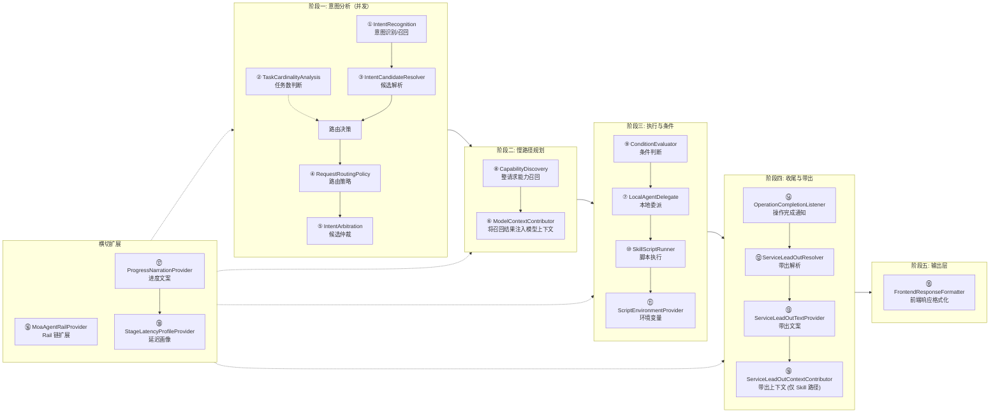

# 意图中控完整流程图 — SPI 扩展点标注（v2）

> 基于最新代码 `phoenix/moa_agent` 重构，对照旧版差异全面更新
> 底座：`moa/phoenix` · 业务扩展：`moa/demo`
> 生成日期：2026-10-12

---

## 〇、与旧版差异速览

| 变更类型 | 旧版 | 新版 | 说明 |
|----------|------|------|------|
| **重命名** | `IntentRecall` | `IntentRecognition` | 意图召回拆分为接口 `IntentRecognition` + 算法工具类 `CandidateRecall` |
| **移除** | `TaskCandidateSelector` | — | 子任务候选筛选改为工具类 `CandidateSelection` / `FastCandidateSelection`（非 SPI） |
| **移除** | `A2ADelegateResponseListener` | — | A2A 响应回调改为 `OperationCompletionListener`（异步通知）+ `LocalAgentDelegate.Step`（同步返回） |
| **新增** | — | `RequestRoutingPolicy` | 路由策略可替换 |
| **新增** | — | `ConditionEvaluator` | 条件判断可替换 |
| **新增** | — | `ServiceLeadOutResolver` | 服务带出解析可替换 |
| **新增** | — | `ServiceLeadOutTextProvider` | 带出文案可替换 |
| **新增** | — | `ServiceLeadOutContextContributor` | 带出上下文可扩展 |
| **新增** | — | `FrontendResponseFormatter` | 前端响应格式化可替换 |
| **新增** | — | `MoaAgentRailProvider` | Rail 链可扩展 |
| **新增** | — | `ProgressNarrationProvider` | 进度播放文案可替换 |
| **新增** | — | `StageLatencyProfileProvider` | 阶段延迟画像可替换 |
| **新增** | — | `OperationCompletionListener` | 操作完成事件观察 |
| **新增** | — | `ModelContextContributor` | 模型上下文可扩展 |
| SPI 总数 | 10 | **19** | — |

---

## 一、完整流程图（Mermaid）

```mermaid
flowchart TD
    %% ===== 入口 =====
    UserReq["👤 用户请求<br/>HTTP POST"]:::userNode
    Adapter["MoaCustomRestAdapter<br/>.toA2ARequest()<br/>HTTP 解包为 A2A 消息"]:::baseNode
    DeepAgent["DeepAgent.invoke()<br/>L1 智能体入口"]:::baseNode

    UserReq --> Adapter --> DeepAgent

    %% ===== Rail 链 beforeInvoke =====
    DeepAgent --> RailBefore["Rail 链 beforeInvoke<br/>按 priority 降序执行"]:::railNode

    %% ===== 会话交互记录 =====
    RailBefore --> ConvRail["ConversationInteractionRail<br/>priority=4000<br/>记录用户输入"]:::railNode

    %% ===== 意图路由分流 =====
    ConvRail --> RouterEntry["IntentRoutingRail<br/>priority=2000<br/>请求路由入口"]:::railNode

    RouterEntry --> CheckContinue{"有活动计划<br/>或中断恢复?"}
    CheckContinue -- "是 (非终态)" --> ContinuePlan["跳过路由<br/>模型继续推进阶段工具<br/>(stage_bind_next 等)"]:::baseNode
    CheckContinue -- "是 (查询挂起任务)" --> SuspendedShow["SuspendedTaskCarryout.present()<br/>展示挂起任务列表<br/>(只读, 不恢复)"]:::baseNode
    CheckContinue -- "否 (新请求)" --> RouteCall["IntentRouter.route()<br/>核心路由器"]:::baseNode

    %% ===== 显式 intent 快捷路径 =====
    RouteCall --> CheckExplicit{"显式 intent<br/>唯一命中?"}
    CheckExplicit -- "是" --> FastDirect

    %% ===== 并发分析 =====
    CheckExplicit -- "否" --> Concurrent["并发执行<br/>moa-intent-N 线程池"]:::baseNode

    Concurrent --> Recognition["① IntentRecognition.recognize()<br/>意图识别/召回<br/><b>SPI ①</b><br/>━━━━━━━━━━━━━━━━━━<br/>底座: PackIntentRecognition<br/>(CandidateRecall 算法召回)<br/>demo: WorkflowIntentRecognition<br/>(HTTP 外部意图工作流)<br/>━━━━━━━━━━━━━━━━━━<br/>开关: external-intent-enabled"]:::spiNode

    Concurrent --> Cardinality["② TaskCardinalityAnalysis.classify()<br/>任务数判断<br/><b>SPI ②</b><br/>━━━━━━━━━━━━━━━━━━<br/>底座: ModelTaskCardinalityAnalysis<br/>(LLM 分类)<br/>demo: HttpTaskCardinalityAnalysis<br/>(HTTP 外部服务)<br/>━━━━━━━━━━━━━━━━━━<br/>返回: SINGLE / MULTIPLE / UNKNOWN<br/>开关: external-cardinality-enabled"]:::spiNode

    %% ===== 候选解析 (仅 demo WorkflowIntentRecognition 路径) =====
    Recognition -. "仅 demo 路径" .-> Resolver["③ IntentCandidateResolver.resolve()<br/>召回意图 → 候选卡解析<br/><b>SPI ③</b><br/>━━━━━━━━━━━━━━━━━━<br/>底座: DefaultIntentCandidateResolver<br/>(精确匹配 + 动态 HIGH 候选)<br/>注: 底座 PackIntentRecognition 不调用此 SPI<br/>demo: WorkflowIntentRecognition 内部调用<br/>FinanceSkillCandidateResolver<br/>(理财意图 → 组合 Skill 卡)<br/>━━━━━━━━━━━━━━━━━━<br/>开关: finance-skill-enabled"]:::spiNode

    Cardinality --> Policy["④ RequestRoutingPolicy.route()<br/>路由策略决策<br/><b>SPI ④</b><br/>━━━━━━━━━━━━━━━━━━<br/>底座: DefaultRequestRoutingPolicy<br/>(组合识别+任务数+仲裁)<br/>demo: DemoRequestRoutingPolicy<br/>(权益领域路由到 moa-benefit)<br/>━━━━━━━━━━━━━━━━━━"]:::spiNode
    Resolver -.-> Policy

    %% ===== 路由决策分支 =====
    Policy --> DecideBranch{"任务数 + 候选数<br/>判断分流"}

    %% --- 快路径: SINGLE + 1候选 ---
    DecideBranch -- "SINGLE + 1候选" --> FastDirect["快路径 FAST<br/>单任务直接委派"]:::fastPath

    %% --- 快路径选择: SINGLE + 多候选 ---
    DecideBranch -- "SINGLE + 多候选" --> Arbitration["⑤ IntentArbitration.select()<br/>候选仲裁<br/><b>SPI ⑤</b><br/>━━━━━━━━━━━━━━━━━━<br/>底座: ModelIntentArbitration<br/>(LLM 筛选 1~3 项)<br/>demo: PassthroughIntentArbitration<br/>(透传全部候选)<br/>━━━━━━━━━━━━━━━━━━<br/>返回: 1-based 序号列表<br/>开关: arbitration-passthrough-enabled"]:::spiNode

    Arbitration --> ArbResult{"仲裁结果"}

    ArbResult -- "1 项" --> FastDirect
    ArbResult -- "2~3 项" --> FastSelect["快路径选择 FAST_SELECT<br/>中断等待用户选择"]:::fastPath
    ArbResult -- "无匹配/失败" --> SlowEntry

    FastSelect --> UserSelect["👤 用户选择候选"]:::userNode
    UserSelect --> FastSelectResume["CandidateSelection.resolve()<br/>CandidateChoices.remember()<br/>(框架工具类, 非 SPI)"]:::baseNode
    FastSelectResume --> FastDirect

    %% --- 慢路径 ---
    DecideBranch -- "MULTIPLE / UNKNOWN" --> SlowEntry["慢路径 SLOW<br/>交给模型规划"]:::slowPath

    %% ===== 快路径执行 =====
    FastDirect --> StartFast["planning.startFast()<br/>创建单 todo, phase=READY"]:::fastPath
    StartFast --> CheckKindFast{"CandidateCard.Kind"}

    CheckKindFast -- "AGENT / WORKFLOW" --> DispatchFast["ExecutionEngine.dispatch()<br/>构造 A2A 委派中断"]:::baseNode
    CheckKindFast -- "SKILL / TOOL" --> LocalFast["⑦ LocalAgentDelegate.start()<br/>本地 Skill 委派<br/><b>SPI ⑦</b>"]:::spiNode

    DispatchFast --> WaitCallback1["⏳ 等待 L2 回调"]:::baseNode
    LocalFast --> SkillExecFast["NativeSkillAgent 执行<br/>本地 Skill 流程"]:::execNode

    WaitCallback1 --> BeforeToolFast["IntentRoutingRail.beforeToolCall()<br/>处理快路径回调"]:::railNode
    SkillExecFast --> BeforeToolFast

    BeforeToolFast --> CheckSwitchFast{"IntentSwitch.detected()?<br/>(仅非 Skill)"}
    CheckSwitchFast -- "是" --> HandleSwitchFast["handleIntentSwitch()<br/>挂起计划 → 重新路由"]:::baseNode
    HandleSwitchFast --> Suspend
    CheckSwitchFast -- "否" --> FinishFast["planning.finishFast()<br/>→ completeExecution()"]:::fastPath

    FinishFast --> CheckDirectFast{"委派类型?"}
    CheckDirectFast -- "直接 A2A<br/>(非 Skill)" --> Completion1["⑭ OperationCompletionListener<br/>.onCompleted()<br/>操作完成通知<br/><b>SPI ⑭</b><br/>━━━━━━━━━━━━━━━━━━<br/>底座: 无默认 (纯扩展点)<br/>demo: IntentConversationHistory<br/>(记录会话历史)<br/>demo: BenefitOperationObserver<br/>(权益操作记录)<br/>━━━━━━━━━━━━━━━━━━"]:::spiNode
    CheckDirectFast -- "Skill 执行" --> SkillCompletion["SkillActionRail 内部<br/>已各自通知 OperationCompletionListener<br/><b>SPI ⑭</b><br/>(Source: SKILL_A2A / SKILL_SCRIPT)"]:::spiNode
    Completion1 --> Terminal
    SkillCompletion --> Terminal

    %% ===== 慢路径: 能力召回 (stage_plan 之前) =====
    SlowEntry --> SlowRecall["⑧ CapabilityDiscovery.recall()<br/>整请求能力召回/补充<br/>在 stage_plan 之前执行一次<br/><b>SPI ⑧</b><br/>━━━━━━━━━━━━━━━━━━<br/>底座: CapabilityDiscovery.catalog()<br/>(目录召回)<br/>demo: FinanceCapabilityDiscovery<br/>(补充理财组合 Skill 卡)<br/>━━━━━━━━━━━━━━━━━━<br/>开关: capability-discovery-enabled"]:::spiNode

    SlowRecall --> BeginRequest["planning.beginRequest()<br/>召回结果存入 plan.recalled<br/>phase: EMPTY"]:::baseNode

    %% ===== 慢路径: RequestCapabilityRail =====
    BeginRequest --> CapRail["RequestCapabilityRail<br/>priority=-10000<br/>beforeModelCall"]:::railNode
    CapRail --> FilterTools["过滤工具白名单为阶段工具<br/>(stage_plan / stage_bind_next / ...)"]:::baseNode
    FilterTools --> CheckReset{"RESET_CONTEXT<br/>== true?"}
    CheckReset -- "是 (首次)" --> InjectCandidates["用 plan.recalled 替换消息列表<br/>UserMessage(query + 候选数据 JSON)<br/>仅保留 SystemMessage"]:::baseNode
    CheckReset -- "否 (续接)" --> ProjectHandoff
    InjectCandidates --> ProjectHandoff["⑥ ModelContextContributor.contribute()<br/>注入服务带出投影到模型上下文<br/><b>SPI ⑥</b><br/>━━━━━━━━━━━━━━━━━━<br/>底座: DefaultModelContextContributor<br/>(LeadOutModelProjection: 将带出展示<br/>插入为伪 AssistantMessage + UserMessage)<br/>demo: 未实现 (用底座默认)<br/>━━━━━━━━━━━━━━━━━━<br/>每次模型调用都执行"]:::spiNode
    ProjectHandoff --> ModelPlan["模型调用 stage_plan<br/>candidate_ids 须来自 plan.recalled"]:::modelNode

    %% ===== 慢路径: StagePlanningRail 状态机 =====
    ModelPlan --> StageRail["StagePlanningRail<br/>priority=1000<br/>beforeToolCall → advancePlan()"]:::railNode

    %% --- 阶段1: plan ---
    StageRail --> StagePlan["阶段1: stage_plan<br/>创建任务清单 1~32 项<br/>校验 candidate_ids ∈ plan.recalled<br/>phase: EMPTY → BINDING"]:::slowStage

    %% --- 阶段2: bind_next ---
    StagePlan --> StageBind["阶段2: stage_bind_next (重复)<br/>绑定下一个 DRAFT todo 候选<br/>从 todo.candidates (已在 plan 时绑定) 选择"]:::slowStage

    StageBind --> BindAuto["CandidateSelection.resolve()<br/>(框架工具类, 非 SPI)"]:::baseNode

    BindAuto --> BindResult{"todo 的<br/>候选数量?"}
    BindResult -- "多候选" --> Clarify["中断澄清<br/>👤 用户选择候选"]:::userNode
    Clarify --> BindAuto
    BindResult -- "单候选" --> StageBound["phase: BINDING → BOUND<br/>全部绑定完成"]:::slowStage

    %% --- 阶段3: finalize ---
    StageBound --> StageFinalize["阶段3: stage_finalize<br/>锁定计划"]:::slowStage
    StageFinalize --> CheckRisk{"HIGH 风险?"}
    CheckRisk -- "是" --> Confirm["plan_confirmation 中断<br/>👤 用户确认"]:::userNode
    Confirm --> StageReady1["phase: CONFIRMING → READY"]:::slowStage
    CheckRisk -- "否" --> StageReady1

    %% --- 阶段4: execute_next ---
    StageReady1 --> StageExecute["阶段4: stage_execute_next (重复)<br/>串行执行下一个 PENDING todo"]:::slowStage
    StageExecute --> Condition["⑨ ConditionEvaluator.evaluate()<br/>条件判断<br/><b>SPI ⑨</b><br/>━━━━━━━━━━━━━━━━━━<br/>底座: ModelConditionEvaluator<br/>(LLM 自然语言判断)<br/>demo: 未实现 (用底座默认)<br/>━━━━━━━━━━━━━━━━━━<br/>返回: PROCEED / SKIP / NEEDS_CLARIFICATION"]:::spiNode

    Condition --> CondResult{"条件求值"}
    CondResult -- "PROCEED" --> ExecDispatch["ExecutionEngine.dispatch()"]:::baseNode
    CondResult -- "SKIP" --> SkipTask["跳过该任务"]:::baseNode
    SkipTask --> NextTask
    CondResult -- "NEEDS_CLARIFICATION" --> BlockTask["阻塞该任务<br/>phase: BLOCKED"]:::slowStage

    %% ===== 执行委派 =====
    ExecDispatch --> CheckKind{"CandidateCard.Kind"}

    CheckKind -- "AGENT / WORKFLOW" --> A2ADelegate["A2A 远程委派<br/>发送到 L2 子代理"]:::execNode
    CheckKind -- "SKILL / TOOL" --> LocalDelegate["⑦ LocalAgentDelegate<br/>.start() / .resume()<br/>本地智能体委派<br/><b>SPI ⑦</b><br/>━━━━━━━━━━━━━━━━━━<br/>底座: LocalSkillDelegate<br/>(同进程 DeepAgent 子智能体)<br/>demo: 未实现 (用底座默认)<br/>━━━━━━━━━━━━━━━━━━"]:::spiNode

    A2ADelegate --> WaitL2["⏳ 等待 L2 响应回调"]:::execNode
    LocalDelegate --> SkillExec["NativeSkillAgent 执行<br/>本地 Skill 流程"]:::execNode

    %% ===== Skill 脚本执行 =====
    SkillExec --> ScriptRunner["⑩ SkillScriptRunner.run()<br/>沙箱脚本执行<br/><b>SPI ⑩</b><br/>━━━━━━━━━━━━━━━━━━<br/>底座: SandboxScriptRunner<br/>demo: 未实现 (用底座默认)<br/>━━━━━━━━━━━━━━━━━━<br/>开关: skill-agent.enabled"]:::spiNode

    ScriptRunner --> EnvProvider["⑪ ScriptEnvironmentProvider<br/>.resolve()<br/>脚本环境变量注入<br/><b>SPI ⑪</b><br/>━━━━━━━━━━━━━━━━━━<br/>底座: SpringScriptEnvironmentProvider<br/>(从 Spring Environment 读取)<br/>demo: 未实现 (用底座默认)<br/>━━━━━━━━━━━━━━━━━━<br/>开关: skill-agent.enabled"]:::spiNode

    %% ===== A2A 响应回调 =====
    WaitL2 --> CallbackRail["IntentRoutingRail.beforeToolCall()<br/>(stage_execute_next 回调)"]:::railNode
    SkillExec --> CallbackRail

    CallbackRail --> CheckSwitchSlow{"IntentSwitch.detected()?<br/>(仅非 Skill)"}
    CheckSwitchSlow -- "是" --> Suspend
    CheckSwitchSlow -- "否" --> ResumeExec["StagePlanningRail.resumeExecution()<br/>→ completeExecution()"]:::baseNode

    ResumeExec --> CheckDirectSlow{"委派类型?"}
    CheckDirectSlow -- "直接 A2A<br/>(非 Skill)" --> CompletionPub["⑭ OperationCompletionListener<br/>.onCompleted()<br/>操作完成通知<br/><b>SPI ⑭</b><br/>━━━━━━━━━━━━━━━━━━<br/>底座: 无默认 (纯扩展点)<br/>demo: IntentConversationHistory<br/>demo: BenefitOperationObserver<br/>━━━━━━━━━━━━━━━━━━"]:::spiNode
    CheckDirectSlow -- "Skill 执行" --> SkillCompletionSlow["SkillActionRail 内部<br/>已各自通知 OperationCompletionListener<br/><b>SPI ⑭</b><br/>(Source: SKILL_A2A / SKILL_SCRIPT)"]:::spiNode

    CompletionPub --> CheckPhaseComplete{"phase == COMPLETED?"}
    SkillCompletionSlow --> CheckPhaseComplete
    CheckPhaseComplete -- "是" --> LeadOut["⑫ ServiceLeadOutResolver.resolve()<br/>服务带出解析<br/><b>SPI ⑫</b><br/>━━━━━━━━━━━━━━━━━━<br/>底座: CompositeServiceLeadOutResolver<br/>(原生元数据 + 规则 + 可选 Skill)<br/>demo: BenefitLeadOutResolver<br/>(权益领域带出)<br/>━━━━━━━━━━━━━━━━━━"]:::spiNode
    CheckPhaseComplete -- "否" --> NextTask

    %% ===== 意图跳变处理 =====
    Suspend["planning.suspend()<br/>挂起当前计划<br/>SuspendedTasks 持久化"]:::baseNode
    Suspend --> ReRoute["获取最新用户原文<br/>重新 route()"]:::baseNode
    ReRoute --> RouteCall

    NextTask -- "是" --> StageExecute
    NextTask -- "否" --> StageComplete["phase: EXECUTING → COMPLETED"]:::slowStage

    SuspendedShow --> Terminal
    ContinuePlan --> Terminal
    StageComplete --> Terminal["🏁 终答返回用户"]:::terminal

    %% ===== 终答输出层 =====
    Terminal --> Formatter["⑮ FrontendResponseFormatter.format()<br/>前端响应格式化<br/><b>SPI ⑮</b><br/>━━━━━━━━━━━━━━━━━━<br/>底座: DefaultFrontendResponseFormatter<br/>(七字段信封封装)<br/>demo: 未实现 (用底座默认)<br/>━━━━━━━━━━━━━━━━━━<br/>开关: custom-rest.query-path"]:::spiNode
    Formatter --> SseOutput["SSE 输出到前端"]:::terminal

    %% ===== 横切: Rail 扩展 =====
    subgraph RailExt["横切: Rail 链扩展"]
        RailProvider["⑯ MoaAgentRailProvider<br/>.createRails()<br/>Rail 扩展注册<br/><b>SPI ⑯</b><br/>━━━━━━━━━━━━━━━━━━<br/>底座: 无默认 (纯扩展点)<br/>demo: 未实现<br/>━━━━━━━━━━━━━━━━━━<br/>Role: MAIN / SKILL"]:::spiNode
    end

    %% ===== 横切: 进度播放 =====
    subgraph Narration["横切: 进度播放 (贯穿全程)"]
        NarrProvider["⑰ ProgressNarrationProvider<br/>.resolve()<br/>进度文案<br/><b>SPI ⑰</b><br/>━━━━━━━━━━━━━━━━━━<br/>底座: DefaultProgressNarrationProvider<br/>demo: FinanceNarrationProvider<br/>(YAML 话术规则)<br/>━━━━━━━━━━━━━━━━━━<br/>开关: narration-enabled"]:::spiNode
        LatencyProvider["⑱ StageLatencyProfileProvider<br/>.resolve()<br/>阶段延迟画像<br/><b>SPI ⑱</b><br/>━━━━━━━━━━━━━━━━━━<br/>底座: 基于配置属性<br/>demo: 未实现 (用底座默认)<br/>━━━━━━━━━━━━━━━━━━"]:::spiNode
        NarrProvider --> LatencyProvider
    end

    LeadOut --> LeadOutText["⑬ ServiceLeadOutTextProvider<br/>.content() / .hint()<br/>带出文案<br/><b>SPI ⑬</b><br/>━━━━━━━━━━━━━━━━━━<br/>底座: 空实现<br/>demo: 未实现 (用底座默认)<br/>━━━━━━━━━━━━━━━━━━"]:::spiNode

    LeadOutText --> LeadOutCtxContrib["⑲ ServiceLeadOutContextContributor<br/>.contribute()<br/>带出上下文贡献<br/>(仅 Skill 带出路径使用)<br/><b>SPI ⑲</b><br/>━━━━━━━━━━━━━━━━━━<br/>底座: 空贡献<br/>demo: 未实现 (用底座默认)<br/>━━━━━━━━━━━━━━━━━━"]:::spiNode

    LeadOutCtxContrib --> NextTask

    %% ===== 样式定义 =====
    classDef userNode fill:#FFE0B2,stroke:#E65100,stroke-width:2px,color:#333
    classDef baseNode fill:#E3F2FD,stroke:#1565C0,stroke-width:1.5px,color:#333
    classDef railNode fill:#FFF9C4,stroke:#F57F17,stroke-width:2px,color:#333
    classDef spiNode fill:#E8F5E9,stroke:#2E7D32,stroke-width:3px,color:#333
    classDef fastPath fill:#E1BEE7,stroke:#6A1B9A,stroke-width:2px,color:#333
    classDef slowPath fill:#FFCDD2,stroke:#C62828,stroke-width:2px,color:#333
    classDef slowStage fill:#FFCDD2,stroke:#C62828,stroke-width:1.5px,color:#333
    classDef modelNode fill:#F3E5F5,stroke:#7B1FA2,stroke-width:2px,color:#333
    classDef execNode fill:#B2DFDB,stroke:#00695C,stroke-width:2px,color:#333
    classDef terminal fill:#C8E6C9,stroke:#1B5E20,stroke-width:3px,color:#333
```



---

## 二、SPI 扩展点在流程中的位置一览



---

## 三、SPI 扩展点完整对照表

| SPI # | 接口 | 流程节点 | 底座默认实现 | demo 实现 | 开关 |
|---|---|---|---|---|---|
| ① | `IntentRecognition` | 意图识别/召回 | `PackIntentRecognition` (CandidateRecall 算法) | `WorkflowIntentRecognition` (HTTP) | `external-intent-enabled` |
| ② | `TaskCardinalityAnalysis` | 任务数判断 | `ModelTaskCardinalityAnalysis` (LLM) | `HttpTaskCardinalityAnalysis` (HTTP) | `external-cardinality-enabled` |
| ③ | `IntentCandidateResolver` | 候选解析（底座不调用，仅 demo 路径） | `DefaultIntentCandidateResolver` | `FinanceSkillCandidateResolver` (理财意图) | `finance-skill-enabled` |
| ④ | `RequestRoutingPolicy` | 路由策略 | `DefaultRequestRoutingPolicy` | `DemoRequestRoutingPolicy` (权益路由) | — |
| ⑤ | `IntentArbitration` | 候选仲裁 | `ModelIntentArbitration` (LLM) | `PassthroughIntentArbitration` (透传) | `arbitration-passthrough-enabled` |
| ⑥ | `ModelContextContributor` | 服务带出投影注入模型上下文（每次模型调用） | `DefaultModelContextContributor` | 未实现 | — |
| ⑦ | `LocalAgentDelegate` | 本地委派执行 | `LocalSkillDelegate` (DeepAgent 子智能体) | 未实现 | `skill-agent.enabled` |
| ⑧ | `CapabilityDiscovery` | 整请求能力召回（stage_plan 之前） | `CapabilityDiscovery.catalog()` | `FinanceCapabilityDiscovery` (组合 Skill) | `capability-discovery-enabled` |
| ⑨ | `ConditionEvaluator` | 条件判断 | `ModelConditionEvaluator` (LLM) | 未实现 | — |
| ⑩ | `SkillScriptRunner` | 脚本执行 | `SandboxScriptRunner` (沙箱) | 未实现 | `skill-agent.enabled` |
| ⑪ | `ScriptEnvironmentProvider` | 环境变量 | `SpringScriptEnvironmentProvider` | 未实现 | `skill-agent.enabled` |
| ⑫ | `ServiceLeadOutResolver` | 带出解析 | `CompositeServiceLeadOutResolver` (原生+规则+可选Skill) | `BenefitLeadOutResolver` (权益带出) | `service-lead-out.skill-enabled` |
| ⑬ | `ServiceLeadOutTextProvider` | 带出文案 | 空实现 | 未实现 | — |
| ⑭ | `OperationCompletionListener` | 操作完成通知 | 无默认 (纯扩展点) | `IntentConversationHistory`; `BenefitOperationObserver` | — |
| ⑮ | `FrontendResponseFormatter` | 前端响应格式化 | `DefaultFrontendResponseFormatter` (七字段信封) | 未实现 | `custom-rest.query-path` |
| ⑯ | `MoaAgentRailProvider` | Rail 链扩展 | 无默认 (纯扩展点) | 未实现 | — |
| ⑰ | `ProgressNarrationProvider` | 进度文案 | `DefaultProgressNarrationProvider` | `FinanceNarrationProvider` (YAML 话术) | `narration-enabled` |
| ⑱ | `StageLatencyProfileProvider` | 阶段延迟画像 | 基于配置属性 | 未实现 | — |
| ⑲ | `ServiceLeadOutContextContributor` | 带出上下文贡献 | 空贡献 | 未实现 | — |

---

## 四、SPI 接口方法签名详解

### 意图分析阶段

```java
// SPI ① 意图识别
@FunctionalInterface
interface IntentRecognition {
    List<CandidateCard> recognize(RoutingAnalysisInput input, Session session);
}

// SPI ② 任务数判断
@FunctionalInterface
interface TaskCardinalityAnalysis {
    TaskCardinality classify(RoutingAnalysisInput input);  // SINGLE / MULTIPLE / UNKNOWN
}

// SPI ③ 候选解析
@FunctionalInterface
interface IntentCandidateResolver {
    List<CandidateCard> resolve(RecalledIntent intent, CandidateResolutionContext context);
}

// SPI ④ 路由策略
@FunctionalInterface
interface RequestRoutingPolicy {
    IntentRouter.Decision route(Request request, RoutingServices services);
}

// SPI ⑤ 候选仲裁
@FunctionalInterface
interface IntentArbitration {
    List<Integer> select(RoutingAnalysisInput input, List<CandidateCard> candidates) throws Exception;
}
```

### 规划与执行阶段

```java
// SPI ⑥ 模型上下文注入
@FunctionalInterface
interface ModelContextContributor {
    void contribute(ModelCallInputs inputs, Context context);
}

// SPI ⑦ 本地委派
interface LocalAgentDelegate {
    Step start(Session session, String parentCallId, LocalExecutionRequest request);
    Step resume(Session session, String parentCallId, Object answer);
    record Step(InterruptRequest interruption, Object result,
                Map<String,Object> responseMetadata, Map<String,Object> completionFacts) {}
}

// SPI ⑧ 能力发现/补充召回
@FunctionalInterface
interface CapabilityDiscovery {
    List<CandidateCard> recall(RoutingAnalysisInput input, List<CandidateCard> routingCandidates);
}

// SPI ⑨ 条件判断
@FunctionalInterface
interface ConditionEvaluator {
    ConditionDecision evaluate(ConditionEvaluationRequest request, Session session);
    // ConditionDecision: PROCEED / SKIP / NEEDS_CLARIFICATION
}

// SPI ⑩ 脚本执行
@FunctionalInterface
interface SkillScriptRunner {
    Map<String, Object> run(Session session, String source, Map<String, Object> input);
    default Map<String, Object> run(Session, String, Map, ScriptEnvironmentContext context) { ... }
}

// SPI ⑪ 环境变量
@FunctionalInterface
interface ScriptEnvironmentProvider {
    Map<String, String> resolve(ScriptEnvironmentContext context);
}
```

### 收尾与带出阶段

```java
// SPI ⑫ 带出解析
@FunctionalInterface
interface ServiceLeadOutResolver {
    Optional<ServiceLeadOut> resolve(ServiceLeadOutContext context);
}

// SPI ⑬ 带出文案
interface ServiceLeadOutTextProvider {
    default String content(ServiceLeadOutContext context, ServiceLeadOut result) { ... }
    default String hint(ServiceLeadOutContext context, ServiceLeadOutItem item) { ... }
}

// SPI ⑭ 操作完成监听
@FunctionalInterface
interface OperationCompletionListener {
    void onCompleted(OperationCompletion completion, OperationCompletionContext context);
}

// SPI ⑲ 带出上下文贡献
@FunctionalInterface
interface ServiceLeadOutContextContributor {
    Map<String, Object> contribute(ServiceLeadOutContext context);
}
```

### 输出层

```java
// SPI ⑮ 前端响应格式化
@FunctionalInterface
interface FrontendResponseFormatter {
    Response format(Request request);
    record Request(OutputEvent output, boolean success, String error,
                   String sseType, Map<String,Object> metadata, Context context) {}
    record Response(String event, String content, Object body, String sseType) {}
}
```

### 横切扩展

```java
// SPI ⑯ Rail 链扩展
interface MoaAgentRailProvider {
    List<AgentRail> createRails(Role role);  // Role: MAIN / SKILL
}

// SPI ⑰ 进度文案
@FunctionalInterface
interface ProgressNarrationProvider {
    Optional<NarrationPlan> resolve(NarrationContext context);
}

// SPI ⑱ 阶段延迟画像
@FunctionalInterface
interface StageLatencyProfileProvider {
    Optional<StageLatencyProfile> resolve(NarrationContext context);
}
```

---

## 五、图例说明

| 颜色 | 含义 |
|---|---|
| 🟧 橙色 | 用户交互节点（用户请求/用户选择/用户确认） |
| 🔵 蓝色 | 底座核心节点（非 SPI） |
| 🟡 黄色 | Rail 编排节点（按 priority 执行） |
| 🟢 绿色（粗边框） | **SPI 扩展点**（19 个） |
| 🟣 紫色 | 快路径节点 |
| 🔴 红色 | 慢路径节点 / 阶段状态 |
| 🟦 青色 | 执行引擎节点 |
| 🟩 深绿 | 终答节点 |

---

## 六、三条路径速览

### 快路径（FAST）— 单任务单候选

```
用户请求 → 意图识别(SPI ①) → 候选解析(SPI ③) → 路由策略(SPI ④): SINGLE+1候选
→ planning.startFast() → ExecutionEngine.dispatch() 或 LocalAgentDelegate(SPI ⑦)
→ 等待回调 → finishFast() → OperationCompletionListener(SPI ⑭)
→ 终答 → FrontendResponseFormatter(SPI ⑮)
```

**SPI 参与**：① ③ ④ ⑦ ⑩ ⑪ ⑭ ⑮ ⑯ ⑰ ⑱

### 快路径选择（FAST_SELECT）— 单任务多候选

```
用户请求 → 意图识别(SPI ①) → 候选解析(SPI ③) → 路由策略(SPI ④): SINGLE+多候选
→ 仲裁(SPI ⑤) → 中断等待用户选择
→ 用户选择 → CandidateSelection.resolve() → 转入快路径执行 → 终答
```

**SPI 参与**：① ③ ④ ⑤ ⑦ ⑩ ⑪ ⑭ ⑮ ⑯ ⑰ ⑱

### 慢路径（SLOW）— 多任务

```
用户请求 → 意图识别(SPI ①) → 候选解析(SPI ③) → 路由策略(SPI ④): MULTIPLE/UNKNOWN
→ CapabilityDiscovery.recall(SPI ⑧) 整请求能力召回 (stage_plan 之前)
→ planning.beginRequest() 召回结果存入 plan.recalled
→ RequestCapabilityRail → ModelContextContributor(SPI ⑥) 将 plan.recalled 注入模型上下文
→ stage_plan (模型创建任务清单, candidate_ids 须来自 plan.recalled)
→ stage_bind_next (从 todo.candidates 中选择, 多候选时中断让用户选)
→ stage_finalize (高风险确认)
→ stage_execute_next:
     → ConditionEvaluator(SPI ⑨) 条件判断
     → ExecutionEngine.dispatch() 或 LocalAgentDelegate(SPI ⑦)
       → SkillScriptRunner(SPI ⑩) + ScriptEnvironmentProvider(SPI ⑪)
     → OperationCompletionListener(SPI ⑭)
     → ServiceLeadOutResolver(SPI ⑫) + ServiceLeadOutTextProvider(SPI ⑬) + ServiceLeadOutContextContributor(SPI ⑲)
→ 意图跳变检测 → 循环执行 → 全部完成 → 终答
```

**SPI 参与**：① ③ ④ ⑥ ⑦ ⑧ ⑨ ⑩ ⑪ ⑫ ⑬ ⑭ ⑮ ⑯ ⑰ ⑱ ⑲

---

## 七、自动配置装配关系

| 配置类 | 加载顺序 | 装配的 SPI Bean |
|---|---|---|
| `IntentCandidateConfiguration` | 1 | CandidatePack, **③ IntentCandidateResolver** |
| `ScriptEnvironmentConfiguration` | 2 | **⑪ ScriptEnvironmentProvider** (条件: `skill-agent.enabled`) |
| `ServiceLeadOutConfiguration` | 3 | **⑫ ServiceLeadOutResolver**, **⑬ ServiceLeadOutTextProvider**, **⑲ ServiceLeadOutContextContributor** |
| `NativeSkillConfiguration` | 4 | **⑦ LocalSkillDelegate**, **⑩ SkillScriptRunner** (条件: `skill-agent.enabled`) |
| `MoaRuntimeAutoConfiguration` | 5 | **① IntentRecognition**, **② TaskCardinalityAnalysis**, **⑤ IntentArbitration**, **④ RequestRoutingPolicy**, **⑥ ModelContextContributor**, **⑧ CapabilityDiscovery**, **⑨ ConditionEvaluator**, **⑯ MoaAgentRailProvider** (收集), **⑭ OperationCompletionListener** (收集) |
| `MoaCustomRestConfiguration` | 6 | **⑮ FrontendResponseFormatter** (条件: `custom-rest.query-path`) |
| `ProgressNarrationConfiguration` | 7 | **⑰ ProgressNarrationProvider**, **⑱ StageLatencyProfileProvider** |
| `ConversationInteractionConfiguration` | 8 | ConversationInteractionPublisher |

---

## 八、@ConditionalOnProperty 开关汇总

| 配置键 | 控制目标 | 所在配置类 |
|---|---|---|
| `moa.skill-agent.enabled=true` | `NativeSkillConfiguration` + `ScriptEnvironmentConfiguration` (SPI ⑦⑩⑪) | 类级别 |
| `moa.service-lead-out.skill-enabled=true` | `SkillServiceLeadOutResolver` 子 Bean (SPI ⑫ 内部组件) | 方法级别 |
| `openjiuwen.service.custom-rest.query-path` | `MoaCustomRestConfiguration` (SPI ⑮) | 类级别 |
| `moa.demo.finance-skill-enabled=true` | `FinanceDemoConfiguration` (SPI ①③⑤⑧ 覆盖) | 类级别 |
| `customer.finance.external-intent-enabled=true` | `WorkflowIntentRecognition` (SPI ① demo) | 方法级别 |
| `customer.finance.arbitration-passthrough-enabled=true` | `PassthroughIntentArbitration` (SPI ⑤ demo) | 方法级别 |
| `customer.finance.capability-discovery-enabled=true` | `FinanceCapabilityDiscovery` (SPI ⑧ demo) | 方法级别 |
| `customer.finance.external-cardinality-enabled=true` | `HttpTaskCardinalityAnalysis` (SPI ② demo) | 方法级别 |
| `customer.finance.narration-enabled=true` | `FinanceNarrationProvider` (SPI ⑰ demo) | 类级别 |

---

## 九、已移除接口对照（旧版 → 新版）

| 旧版 SPI | 新版替代 | 说明 |
|---|---|---|
| `IntentRecall` | `IntentRecognition` (SPI ①) + `CandidateRecall` (工具类) | 意图召回拆分为接口 + 算法工具类，接口更名为 `IntentRecognition`，方法签名为 `recognize()` |
| `TaskCandidateSelector` | `CandidateSelection` + `FastCandidateSelection` (工具类) | 子任务候选筛选不再作为 SPI，改为框架内置工具类 |
| `A2ADelegateResponseListener` | `OperationCompletionListener` (SPI ⑭) + `LocalAgentDelegate.Step` | A2A 响应回调拆分为异步事件通知 + 同步返回值 |

---

*文档结束*
