# 意图中控流程图 — 精简版（fin 0.1.1）

> 基于 [意图中控流程图-SPI扩展点标注.md](./意图中控流程图-SPI扩展点标注.md) 精简，只保留主干：快/慢路径分流、慢路径规划执行、SKILL 引擎路径
> 生成日期：2026-10-22

---

## 一、主流程图

```mermaid
flowchart TD
    UserReq["👤 用户请求<br/>HTTP POST"]:::userNode
    DeepAgent["DeepAgent.invoke()<br/>L1 主智能体入口"]:::baseNode
    RouterEntry["IntentRoutingRail.beforeInvoke()<br/>priority=2000<br/>会话有活动计划则跳过路由"]:::railNode

    UserReq --> DeepAgent --> RouterEntry

    %% ===== 路由分析 =====
    RouterEntry --> RouteCall["IntentRouter.route()"]:::baseNode

    RouteCall --> Handoff["IntentHandoff 交接预处理<br/>(TARGET→快 / COMPOSE→慢)"]:::baseNode
    Handoff --> Explicit{"显式 intent<br/>唯一命中?"}
    Explicit -- "是" --> FastDirect
    Explicit -- "否" --> Concurrent["并发分析 (moa-intent-N 线程池)"]:::baseNode

    Concurrent --> Recognition["① IntentRecognition.recognize()<br/>意图召回<br/>底座: PackIntentRecognition<br/>(确定性算法, 无 LLM)"]:::spiNode
    Concurrent --> Cardinality["② TaskCardinalityAnalysis.classify()<br/>任务数判断 (LLM)<br/>SINGLE / MULTIPLE / UNKNOWN"]:::spiNode

    Recognition --> Policy["④ RequestRoutingPolicy.route()<br/>路由策略<br/>底座: DefaultRequestRoutingPolicy"]:::spiNode
    Cardinality --> Policy

    Policy --> Decide{"分流决策<br/>(任务数 + 候选数)"}

    %% ===== 快路径 =====
    Decide -- "SINGLE + 1 候选" --> FastDirect["快路径 FAST<br/>单任务直接委派"]:::fastPath

    Decide -- "SINGLE + 多候选" --> RefOrArb["指代消解 (CandidateChoices)<br/>未命中 → ⑤ IntentArbitration 仲裁 (LLM)<br/>底座: ModelIntentArbitration"]:::baseNode
    RefOrArb -- "仲裁 1 项" --> FastDirect
    RefOrArb -- "仲裁 2~3 项" --> FastSelect["快路径选择 FAST_SELECT<br/>中断等用户选择 → 选定后转 FAST"]:::fastPath
    RefOrArb -- "仲裁空/失败/失败兜底" --> SlowEntry

    %% ===== 慢路径 =====
    Decide -- "MULTIPLE / UNKNOWN" --> SlowEntry["慢路径 SLOW<br/>交给模型规划"]:::slowPath

    SlowEntry --> SlowRecall["⑥ CapabilityDiscovery.recall()<br/>整请求能力召回<br/>底座: catalog (复用路由候选)"]:::spiNode
    SlowRecall --> BeginRequest["planning.beginRequest()<br/>召回存入 plan.recalled"]:::baseNode

    BeginRequest --> CapRail["RequestCapabilityRail (priority=-10000)<br/>工具白名单=5个阶段工具<br/>首轮流重置上下文 + ⑦ 带出投影注入<br/>底座: DefaultModelContextContributor"]:::railNode

    CapRail --> StageRail["StagePlanningRail (priority=1000)<br/>阶段状态机"]:::railNode

    StageRail --> StagePlanTool["stage_plan<br/>模型创建任务清单 1~32 项<br/>candidate_ids ⊆ recalled<br/>phase: EMPTY → BINDING"]:::slowStage
    StagePlanTool --> StageBind["stage_bind_next ×N<br/>绑定候选: 单候选自动, 多候选中断用户选<br/>phase: BINDING → BOUND"]:::slowStage
    StageBind --> StageFinalize["stage_finalize<br/>HIGH 风险 → plan_confirmation 用户确认<br/>phase: BOUND/CONFIRMING → READY"]:::slowStage
    StageFinalize --> StageExecute["stage_execute_next (循环)<br/>串行执行 PENDING todo<br/>phase: READY → EXECUTING"]:::slowStage

    StageExecute --> Condition{"⑧ ConditionEvaluator<br/>条件判断 (LLM)<br/>底座: ModelConditionEvaluator"}:::spiNode
    Condition -- "PROCEED" --> ExecDispatch
    Condition -- "SKIP" --> NextTask
    Condition -- "NEEDS_CLARIFICATION" --> BlockTask["todo + 计划 BLOCKED"]:::slowStage

    %% ===== 执行委派 =====
    ExecDispatch{"CandidateCard.Kind?"}
    Condition -- "PROCEED" --> ExecDispatch
    ExecDispatch -- "AGENT / WORKFLOW" --> A2ADelegate["⑨ ExecutionEngine.Executor<br/>A2A 远程委派 → L2 子代理"]:::spiNode
    ExecDispatch -- "SKILL / TOOL" --> SkillEntry["⑩ LocalAgentDelegate.start()<br/>本地 SKILL 委派<br/>底座: LocalSkillDelegate"]:::spiNode

    %% ===== SKILL 引擎 =====
    subgraph SkillEngine["SKILL 子智能体引擎 (隔离的 DeepAgent 实例)"]
        direction TB
        SkillChain["SKILL Rail 链:<br/>SkillBoundaryRail(2000) → SkillNarrationRail(1900)<br/>→ SkillActionRail(1500) → SkillInteractionRail"]
        SkillTools["模型调用业务/控制工具:<br/>call_versatile / call_mcp / confirm_action<br/>/ read_file / skill_results / cancel_skill"]
        ScriptRunner["⑪ SkillScriptRunner 沙箱脚本 (python)<br/>底座: SandboxScriptRunner<br/>⑫ ScriptEnvironmentProvider 环境变量"]
        SkillChain --> SkillTools --> ScriptRunner
    end

    SkillEntry --> SkillChain
    A2ADelegate --> WaitL2["⏳ 等待回调<br/>(a2a_delegate / stage_execute_next)"]:::execNode

    ScriptRunner --> WaitL2
    WaitL2 --> CheckSwitch{"意图跳变?<br/>(IntentSwitch.detected, 仅非 SKILL)"}
    CheckSwitch -- "领域内跳变<br/>(in_scope)" --> RouteInScope["routeInScope: 换候选<br/>直接转快路径"]:::baseNode
    RouteInScope --> FastDirect
    CheckSwitch -- "跨域" --> Suspend["planning.suspend() 挂起<br/>→ 重新 route()"]:::baseNode
    Suspend --> RouteCall
    CheckSwitch -- "否" --> CompleteExec["completeExecution()<br/>todo → SUCCEEDED/FAILED"]:::baseNode

    CompleteExec --> Completion["⑬ OperationCompletionListener<br/>操作完成通知<br/>底座: 无默认 (纯扩展点)"]:::spiNode
    Completion --> CheckComplete{"全部完成?<br/>phase → COMPLETED"}
    CheckComplete -- "否" --> NextTask{"还有 PENDING?"}
    NextTask -- "是" --> StageExecute
    NextTask -- "否" --> LeadOut

    CheckComplete -- "是" --> LeadOut["⑭ ServiceLeadOutResolver 服务带出<br/>底座: Composite (Default→Skill→Rule)<br/>→ 带出文案/前端事件/承接登记"]:::spiNode

    LeadOut --> Terminal
    FastDirect --> FastExec["planning.startFast()<br/>单 todo → 委派执行<br/>(同上方 Kind 分发)"]:::fastPath
    FastExec --> WaitL2
    BlockTask --> Terminal

    LeadOut --> Terminal["🏁 终答<br/>⑲ FrontendResponseFormatter<br/>底座: 七字段信封 → SSE 输出"]:::terminal

    %% ===== 横切 =====
    subgraph Cross["横切 (贯穿全程)"]
        Narration["㉒ 进度播放: ProgressNarrationProvider<br/>㉑ Rail 链扩展: MoaAgentRailProvider"]:::spiNode
    end
    Cross -.-> RouteCall

    %% ===== 样式 =====
    classDef userNode fill:#FFE0B2,stroke:#E65100,stroke-width:2px,color:#333
    classDef baseNode fill:#E3F2FD,stroke:#1565C0,stroke-width:1.5px,color:#333
    classDef railNode fill:#FFF9C4,stroke:#F57F17,stroke-width:2px,color:#333
    classDef spiNode fill:#E8F5E9,stroke:#2E7D32,stroke-width:3px,color:#333
    classDef fastPath fill:#E1BEE7,stroke:#6A1B9A,stroke-width:2px,color:#333
    classDef slowPath fill:#FFCDD2,stroke:#C62828,stroke-width:2px,color:#333
    classDef slowStage fill:#FFCDD2,stroke:#C62828,stroke-width:1.5px,color:#333
    classDef execNode fill:#B2DFDB,stroke:#00695C,stroke-width:2px,color:#333
    classDef terminal fill:#C8E6C9,stroke:#1B5E20,stroke-width:3px,color:#333
```



---

## 二、三条主干路径速览

### 快路径（FAST）— 单任务单候选

```
route() → 交接 TARGET / 显式 intent 唯一命中 / SINGLE+1候选
→ startFast (单 todo, phase=READY)
→ Kind 分发: AGENT/WORKFLOW → ⑨ A2A 委派 | SKILL → ⑩ 本地委派
→ 等回调 → 意图跳变检测(非 SKILL) → finishFast → ⑬ 完成通知 → 终答
```

### 慢路径（SLOW）— 多任务规划

```
route() → MULTIPLE/UNKNOWN (或仲裁失败兜底)
→ ⑥ 整请求能力召回 → beginRequest (存 plan.recalled)
→ RequestCapabilityRail: 阶段工具白名单 + 首轮上下文重置 + ⑦ 带出投影
→ 模型四阶段状态机:
     stage_plan     创建任务清单 (candidate_ids 须来自召回)
     stage_bind_next 逐个绑定候选 (多候选 → 中断用户选)
     stage_finalize 高风险确认 (plan_confirmation)
     stage_execute_next 循环: ⑧ 条件判断 → 委派执行 → 回调 → 完成
→ ⑭ 服务带出 (phase=COMPLETED 时) → 终答
```

### SKILL 引擎路径 — 如何走到

```
委派分发点: CandidateCard.Kind == SKILL (或 TOOL)
→ ⑩ LocalAgentDelegate.start()  [底座: LocalSkillDelegate]
   构造 native_skill_v1 协议报文, 创建隔离子会话
→ 启动独立的 NativeSkillAgent (DeepAgent 实例, 不共享主链 Rail)
→ SKILL Rail 链: Boundary(信封/幂等/白名单) → Narration → Action(业务核心)
→ 模型调用 call_versatile / call_mcp / confirm_action 等工具
→ ⑪ SkillScriptRunner 沙箱执行 python 脚本 (⑫ 环境变量注入)
→ 中断透传父级 (AskUser/confirm_action) | 完成后 Step.result 返回主链
→ ⑬ 完成通知 (Source: SKILL_A2A / SKILL_SCRIPT)
```

---

## 三、核心 SPI 速查（主干涉及）

| SPI | 节点 | 底座默认实现 |
|---|---|---|
| ① IntentRecognition | 意图召回 | PackIntentRecognition（确定性算法） |
| ② TaskCardinalityAnalysis | 任务数判断 | ModelTaskCardinalityAnalysis（LLM） |
| ④ RequestRoutingPolicy | 路由策略 | DefaultRequestRoutingPolicy |
| ⑤ IntentArbitration | 候选仲裁 | ModelIntentArbitration（LLM） |
| ⑥ CapabilityDiscovery | 慢路径能力召回 | catalog（复用路由候选） |
| ⑧ ConditionEvaluator | 执行前条件判断 | ModelConditionEvaluator（LLM） |
| ⑨ ExecutionEngine.Executor | A2A 委派执行器 | A2A 执行器（默认） |
| ⑩ LocalAgentDelegate | SKILL 本地委派 | LocalSkillDelegate |
| ⑪ SkillScriptRunner | SKILL 脚本沙箱 | SandboxScriptRunner |
| ⑫ ScriptEnvironmentProvider | 脚本环境变量 | SpringScriptEnvironmentProvider |
| ⑬ OperationCompletionListener | 操作完成通知 | 无默认（纯扩展点） |
| ⑭ ServiceLeadOutResolver | 服务带出解析 | Composite（Default→Skill→Rule） |
| ⑲ FrontendResponseFormatter | 终答格式化 | DefaultFrontendResponseFormatter |

> 完整 24 个 SPI 及方法签名见详细版文档。

---

*文档结束*
